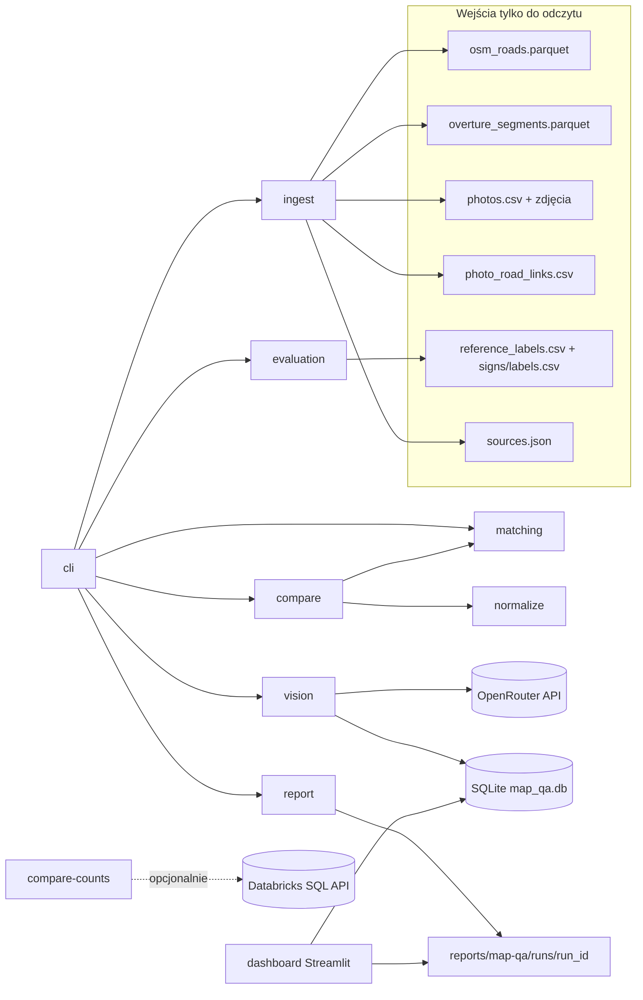
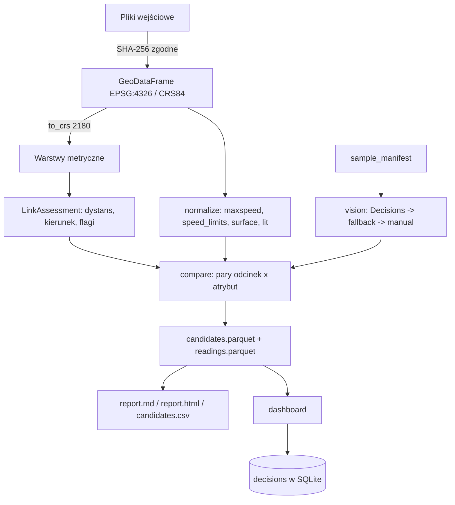
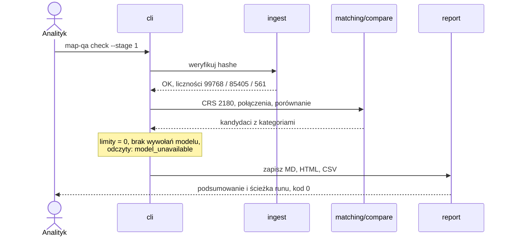
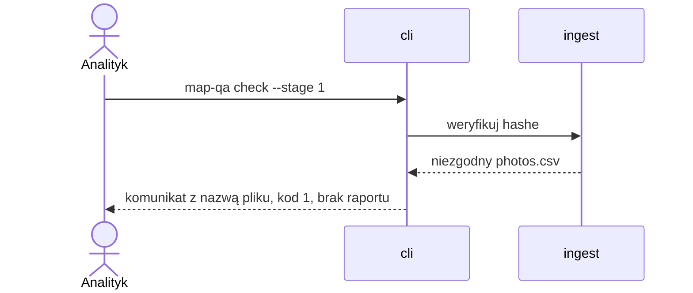

# ADR-000: Kontrola mapy — architektura główna

**Data:** 2026-11-03
**Status:** Accepted
**PRD:** [docs/PRD.md](../PRD.md)
**Profil danych:** [reports/map-qa/profile.md](../../reports/map-qa/profile.md) (krok 0b, 2026-11-03) potwierdza liczby z sekcji 5.1 i schemat Overture. Otwarta sprawa z profilu: hashe plików tekstowych a CRLF na Windows (sekcja 11).

Pliki szczegółowe:

| ADR | Zakres |
|---|---|
| [001-dane-normalizacja-dopasowanie.md](001-dane-normalizacja-dopasowanie.md) | Wczytanie, integralność, CRS, normalizacja `maxspeed`/`speed_limits`/nawierzchni, łączenie zdjęcia z drogą, porównanie atrybutów |
| [002-odczyt-zdjec-modelami.md](002-odczyt-zdjec-modelami.md) | Kontrakt OpenRouter Decisions, eskalacja do LLM, limity, koszt, cache, capture, ewaluacja |
| [003-raport-i-dashboard.md](003-raport-i-dashboard.md) | Raport MD/HTML/CSV, dashboard Streamlit, zapis decyzji w SQLite |

---

## 1. Przegląd

Budujemy lokalne narzędzie CLI w Pythonie 3.12, które z przypiętego snapshotu OSM, Overture i zdjęć Krakowa tworzy listę kandydatów do ręcznej kontroli (PRD §4.1), opcjonalnie odczytuje widoczne cechy zdjęć modelami przez OpenRouter (PRD §11) i zapisuje raport. Dashboard Streamlit (etap 3) pozwala analitykowi zapisać decyzję, a edytorowi OSM obejrzeć potwierdzone przypadki. ADR rozstrzyga technologię, kontrakty modułów i testy; zachowanie biznesowe i kryteria akceptacji pozostają w PRD.

---

## 2. Dokumentacja technologii

Wersje sprawdzone w PyPI 2026-11-03. Implementujący agent przypina je w `app/pyproject.toml` (dokładne `==`) i `uv.lock`.

| Biblioteka | Wersja | Context7 ID lub dokumentacja | Użycie |
|---|---|---|---|
| Python | 3.12 | https://docs.python.org/3.12/ | Runtime (`.python-version`) |
| uv | wersja z VM | https://docs.astral.sh/uv/ | Projekt, lock, uruchamianie |
| geopandas | 1.2.0 | `/geopandas/geopandas` | Wczytanie GeoParquet, `to_crs`, `sjoin_nearest` |
| shapely | 2.2.0 | https://shapely.readthedocs.io/en/stable/ | Geometria, kierunek lokalny |
| pyproj | 3.8.0 | https://pyproj4.github.io/pyproj/stable/ | Transformacje CRS |
| pyarrow | 23.0.1 | https://arrow.apache.org/docs/python/ | Odczyt Parquet (wersja z README danych) |
| duckdb | 1.5.6 | `/websites/duckdb_current`; https://duckdb.org/docs/stable/core_extensions/spatial/overview | Tylko profil i agregacje (wersja z README danych; 2.0.0 dostępna) |
| openrouter (SDK) | 1.3.107 | `/openrouterteam/python-sdk`; https://openrouter.ai/docs/client-sdks/python/sdks/decisions/README | Decisions i chat |
| jinja2 | 3.1.6 | https://jinja.palletsprojects.com/en/stable/ | Szablony raportu MD/HTML |
| streamlit | 1.66.1 | `/streamlit/docs`; https://docs.streamlit.io | Dashboard |
| Pillow | 12.0.0 | https://pillow.readthedocs.io/en/stable/ | Zmniejszenie obrazu przed wysłaniem (wersja z README danych) |
| pytest | najnowsza przy `uv add`, zapisana w lock | https://docs.pytest.org/en/stable/ | Testy |
| Playwright CLI | wersja z VM | https://playwright.dev/docs/test-cli | E2E i Manual QA dashboardu |
| SQLite | biblioteka standardowa `sqlite3` | https://docs.python.org/3.12/library/sqlite3.html | Decyzje, cache, budżet |
| Databricks SQL Statement Execution API 2.0 | — | https://docs.databricks.com/aws/en/dev-tools/sql-execution-tutorial | Opcjonalne porównanie liczności |

Niezweryfikowane w dokumentacji (sprawdzić przed użyciem, nie zgadywać): parametr `timeout_ms` w `alpha.decisions.create`, nazwy argumentów konstruktora klienta SDK, położenie `provider.require_parameters` w chat, strony modeli `openai/gpt-6-luna-decisions` i `typesafe/jev-1.14` (404 na stronie modelu; cena potwierdzona przez publiczny endpoint `/api/v1/models/{id}/endpoints`).

---

## 3. Architektura systemu

### Wzorzec
Lokalny monolit: jeden pakiet Pythona, dwa punkty wejścia (CLI i dashboard). Brak serwera, kolejki i chmury. Pipeline jest wsadowy i deterministyczny dla tych samych wejść, limitów i cache.

### Struktura repozytorium

| Ścieżka | Zawartość |
|---|---|
| `app/pyproject.toml`, `app/uv.lock`, `app/.python-version` | Projekt uv, Python 3.12, przypięte zależności |
| `app/src/map_qa/` | Pakiet: moduły z sekcji 4 |
| `app/src/map_qa/templates/` | Szablony Jinja2 raportu |
| `app/dashboard/app.py` | Aplikacja Streamlit |
| `app/tests/unit/`, `app/tests/integration/`, `app/tests/e2e/` | Warstwy testów |
| `app/tests/fixtures/captures/` | Bezpieczne capture rzeczywistych odpowiedzi API |
| `app/tests/fixtures/rows/` | Wybrane prawdziwe wiersze danych map-qa (kopie, nie wejścia) |
| `app/config/thresholds.toml` | Progi i wersja pytań, zatwierdzane commitem przed końcową próbą |
| `reports/map-qa/runs/<run_id>/` | Wynik kontroli (ignorowany w Git) |
| `course-materials/exercise-data/map-qa/data/map_qa.db` | SQLite: decyzje, cache, budżet (katalog ignorowany w Git) |

Wejścia w `course-materials/exercise-data/map-qa/` są tylko do odczytu.

### Stos technologiczny

| Warstwa | Technologia | Powód |
|---|---|---|
| Obliczenia przestrzenne | GeoPandas + Shapely + pyproj | Jawne `to_crs(2180)`, łatwe testy jednostkowe na małych GeoDataFrame |
| Profil i agregacje | DuckDB spatial | Szybkie liczności na 100 tys. dróg bez ładowania do pamięci; nie w ścieżce pipeline'u |
| Źródło danych | Lokalne GeoParquet/CSV | Działa offline, ma hashe w `sources.json` |
| Źródło opcjonalne | Databricks SQL Statement Execution API przez `urllib` | Pięć zapytań `count(*)`; brak nowej zależności |
| Model decyzyjny | `openai/gpt-6-luna-decisions` (główny), `typesafe/jev-1.14` (porównawczy) | Pytanie `choice` zwraca prawdopodobieństwa do progu abstencji |
| LLM drugiego stopnia | `openai/gpt-6-luna` przez chat, `reasoning.effort=medium`, structured output | Obsługuje obrazy, reasoning i `response_format`; tani |
| Klient API | Oficjalny SDK `openrouter` 1.3.107 | Typowane odpowiedzi i błędy; retry wyłączone jawnie |
| Raport | Jinja2 (autoescape dla HTML) + pandas CSV | Tagi OSM to niezaufany tekst; jeden szablon na format |
| Dashboard | Streamlit | Lokalna aplikacja w przeglądarce, QA przez Playwright CLI |
| Trwały stan | SQLite (`sqlite3`) | Transakcyjny zapis decyzji, cache i licznika budżetu; biblioteka standardowa |

---

## 4. Moduły i zależności

Kierunek zależności: `cli` → (`ingest`, `matching`, `compare`, `vision`, `evaluation`, `report`) → (`normalize`, `store`, `config`). `dashboard` → (`store`, `config`) i wyniki z katalogu runu. Bez cykli; `normalize` i `config` nie zależą od niczego w pakiecie.

| Moduł | Odpowiedzialność | Zależy od |
|---|---|---|
| `config` | Ścieżki, progi i wersja pytań z `thresholds.toml`, limity z CLI | — |
| `ingest` | Weryfikacja rozmiarów i SHA-256 z `sources.json`, wczytanie warstw, raport liczności | `config` |
| `normalize` | Funkcje czyste: parsowanie `maxspeed*`, reguł Overture, nawierzchni, `lit` | — |
| `matching` | CRS 2180, walidacja kandydatów połączeń, flagi niepewności | `config` |
| `compare` | Pary (odcinek, atrybut), kategorie i przyczyny | `normalize`, `matching` |
| `vision` | Próbka, budżet, cache, Decisions, eskalacja do LLM | `store`, `config` |
| `evaluation` | Trafność i pokrycie na etykietach referencyjnych | `config` |
| `report` | MD/HTML/CSV z wyników runu | `config` |
| `store` | Schemat SQLite i operacje: decyzje, cache, budżet, runy | — |
| `sources_remote` | Opcjonalne liczności z Databricks | `config` |
| `cli` | Komendy i kody wyjścia | wszystkie powyżej |
| `dashboard/app.py` | UI Streamlit | `store`, `config` |

---

## 5. Modele danych

### 5.1. Fakty o wejściach (odczyt 2026-11-03)
- `photo_road_links.csv`: 561 wierszy; `match_method`: 557 `osm_source_reference`, 3 `none`, 1 `spatial_fallback`. Flagi: `ambiguous_candidates` 65, `camera_against_way_direction` 35, `panorama_heading_ambiguous` 31, `poor_heading_alignment` 27, `boundary_crossing` 27, `missing_heading` 15, `service_way` 14, `no_osm_within_25m` 3, `overture_spatial_only` 1. Flagi rozdzielone `;`.
- `reference_labels.csv`: `certain` — surface 99, junction_visible 92, street_lighting_visible 79, speed_limit_value 14.
- `signs/labels.csv`: 119 wierszy, 115 `certain`; wartości 20–120, `none` 25, `unreadable` 1; kolumna `sign_value`.
- `tags` w OSM to JSON z pełnymi tagami; obecne m.in. `maxspeed:conditional` (np. `110 @ (Mo-Fr 06:00-18:00)`), `maxspeed:type=PL:urban`, `maxspeed:hgv/bus/trailer`.

### 5.2. Encje

| Encja | Kluczowe pola | Relacje | Trwałość |
|---|---|---|---|
| `Run` | `run_id` (czas UTC + krótki hash), etap, limity, wersja pytań, wersje źródeł, CRS, status | ma `Candidate`, `VisionReading` | SQLite `runs` + katalog runu |
| `Candidate` | `candidate_id` (hash z run_id, osm_id, overture_id, atrybut), `osm_id`, `overture_id?`, atrybut, surowe wartości OSM i Overture (tekst/JSON), wartości znormalizowane, daty źródeł, `photo_id?`, kategoria, lista przyczyn, opis powodu | należy do `Run`; ma 0..1 `VisionReading` na pytanie | `candidates.parquet` + CSV w katalogu runu |
| `LinkAssessment` | `photo_id`, `osm_way_id?`, `overture_id?`, dystans m (przeliczony), `bearing_diff`, `match_method`, flagi wejściowe, `is_uncertain`, przyczyny | łączy zdjęcie z `Candidate` | w `candidates.parquet` |
| `VisionReading` | `photo_id`, pytanie, stopień (`decision`/`fallback`/`manual`), model, odpowiedź, prawdopodobieństwa, `confidence`, przyczyna, `image_sha256`, `cache_hit`, koszt | należy do `Run` | `readings.parquet` + SQLite cache |
| `Decision` | `candidate_key` (bez run_id: osm_id, overture_id, atrybut), decyzja, wartość proponowana, komentarz, autor, czas UTC | odnosi się do kandydata w kolejnych runach | SQLite `decisions`, bezterminowo |
| `ModelCacheEntry` | klucz: `image_sha256` + `model` + `question_id` + `questions_version`; odpowiedź JSON bez sekretów, czas | — | SQLite `model_cache` |
| `BudgetLedger` | `run_id`, `model`, liczba wysłanych żądań, liczba błędów, suma kosztu USD, `disabled` | należy do `Run` | SQLite `budget_ledger` |

---

## 6. Kontrakty interfejsów

### CLI `map-qa check`
- **Wejście:** `--stage {1,2}` (wymagane), `--decision-limit N` (domyślnie 0, maks. 25), `--comparison-limit N` (domyślnie 0, maks. 5), `--fallback-limit N` (domyślnie 0, maks. 10), `--max-cost-usd X` (domyślnie 0), `--out` (domyślnie `reports/map-qa/runs/`).
- **Walidacja:** limit powyżej maksimum lub limit > 0 przy `--max-cost-usd 0` → kod 2 i komunikat po polsku, przed wczytaniem danych.
- **Wyjście:** katalog runu z `report.md`, `report.html`, `candidates.csv`, `candidates.parquet`, `readings.parquet`, `sample_manifest.csv` (gdy limit > 0), `run.json`; podsumowanie na stdout.
- **Kody wyjścia:** 0 sukces (także bez modelu i przy niedostępnych źródłach opcjonalnych), 1 niezgodny hash lub brak pliku wejściowego, 2 błędne argumenty, 3 nieoczekiwany błąd. Przy kodzie ≠ 0 katalog runu nie zawiera raportu.

### CLI `map-qa compare-counts`
- **Wejście:** zmienne `DATABRICKS_HOST`, `DATABRICKS_TOKEN`, `DATABRICKS_SQL_WAREHOUSE_ID`.
- **Wyjście:** tabela liczności plik vs tabela dla pięciu tabel `workspace.map_qa`; brak zmiennych lub błąd HTTP → wpis „Ograniczenia” i kod 0.

### Dashboard
- `uv run streamlit run dashboard/app.py` z katalogu `app/`; czyta najnowszy run i SQLite. Kontrakt UI w ADR-003.

### API zewnętrzne
- OpenRouter Decisions i chat — kontrakt w ADR-002.

---

## 7. Zmienne środowiskowe

Aplikacja sprawdza tylko obecność zmiennych; nigdy nie wypisuje, nie loguje i nie zapisuje ich wartości. Nie czyta `.env`.

| Zmienna | Cel | Wymagana | Przykład |
|---|---|---|---|
| `OPENROUTER_API_KEY` | Decisions i chat | Tylko gdy dowolny limit modelu > 0 | `<sekret>` |
| `DATABRICKS_HOST` | Host workspace | Tylko `compare-counts` | `https://<workspace>.cloud.databricks.com` |
| `DATABRICKS_TOKEN` | Token SQL | Tylko `compare-counts` | `<sekret>` |
| `DATABRICKS_SQL_WAREHOUSE_ID` | Warehouse | Tylko `compare-counts` | `<id z DATABRICKS.md>` |

---

## 8. Decyzje techniczne

### D-01: GeoPandas w pipeline, DuckDB tylko do profilu
**Status:** Accepted · **Data:** 2026-11-03
**Context:** Pipeline liczy dystanse, kierunki i dopasowania na ~100 tys. dróg i 561 zdjęciach; reguły muszą być testowalne na kilku wierszach.
**Decision:** GeoPandas/Shapely/pyproj dla wszystkich obliczeń w pipeline; DuckDB spatial wyłącznie w profilu i ad hoc liczności.
**Rejected alternatives:**
- DuckDB spatial wszędzie: wymaga `always_xy := true` w każdym `ST_Transform` (EPSG:4326 to lat/lon), a reguły w SQL są trudniejsze do testów jednostkowych.
- Tylko GeoPandas: profil 100 tys. rekordów z tagami JSON jest wolniejszy i dłuższy w kodzie.
**Consequences:** (+) proste testy na GeoDataFrame z kilku wierszy. (−) całe warstwy w pamięci (~25 MB Parquet, mieści się na VM).
**Review trigger:** obszar większy niż województwo albo czas wczytania > 60 s na VM.

### D-02: Lokalne pliki jako jedyne źródło pipeline'u
**Status:** Accepted · **Data:** 2026-11-03
**Context:** PRD wymaga pracy offline i weryfikacji hashy; Databricks jest współdzielony i opcjonalny.
**Decision:** Pipeline czyta wyłącznie lokalny snapshot. Databricks służy tylko komendzie `compare-counts` przez SQL Statement Execution API 2.0 (`POST /api/2.0/sql/statements/`, `wait_timeout` 30 s, `disposition` INLINE, `format` JSON_ARRAY), wywołanej przez `urllib` z biblioteki standardowej.
**Rejected alternatives:**
- Databricks jako źródło główne: brak offline, koszt warehouse, limit INLINE 25 MiB.
- Databricks CLI: dodatkowa instalacja; nie potrzebna dla pięciu `count(*)`.
- MCP: rozszerzenie M2, nie część aplikacji.
**Consequences:** (+) deterministyczne wejścia z hashami. (−) Databricks nie jest testowany w pipeline.
**Review trigger:** dane przestają mieścić się lokalnie albo tabele chmurowe zaczynają różnić się od plików.

### D-03: Oficjalny SDK `openrouter` z jawnie wyłączonym retry
**Status:** Accepted · **Data:** 2026-11-03
**Context:** Każde żądanie jest płatne i liczone do limitu; domyślne retry SDK to backoff do 1 godziny.
**Decision:** SDK `openrouter==1.3.107`; każde wywołanie z konfiguracją retry o strategii `none` i timeoutem 40 s. Nie używamy klienta OpenAI.
**Rejected alternatives:**
- Surowy POST `https://openrouter.ai/api/alpha/decisions`: pełna kontrola, ale ręczne typy odpowiedzi i błędów.
- Klient OpenAI: nie obsługuje Decisions; wykluczony w poleceniu.
**Consequences:** (+) typowane `DecisionsResponse` i klasy błędów per status. (−) API alpha może zmienić się między wersjami SDK; wymaga przypięcia i capture.
**Review trigger:** SDK nie pozwala ustawić timeoutu dla `decisions.create` (niezweryfikowane) — wtedy surowy POST przez `urllib` dla Decisions.

### D-04: Modele
**Status:** Accepted · **Data:** 2026-11-03
**Context:** PRD: model główny (25 żądań), porównawczy (5), drugi stopień (10).
**Decision:** Główny `openai/gpt-6-luna-decisions` ($0.10/M tokenów wejścia); porównawczy `typesafe/jev-1.14` ($0.042/M); drugi stopień `openai/gpt-6-luna` przez chat ($0.10/M wejście, $0.50/M wyjście), `reasoning.effort = medium`.
**Rejected alternatives:**
- Jev jako główny: tańszy, ale wymaga obrazów 256–1568 px i JPEG/PNG; zostawiamy go do porównania na tych samych zdjęciach.
- `google/gemini-3.8-flash` jako drugi stopień: niezależna rodzina modeli, ale ~7,5× droższe wejście.
**Consequences:** (+) koszt próby rzędu centów. (−) drugi stopień z tej samej rodziny co główny może powielać jego błędy.
**Review trigger:** drugi stopień rozstrzyga < 20% eskalacji w próbie walidacyjnej albo model zniknie z `/api/v1/models`.

### D-05: SQLite dla stanu
**Status:** Accepted · **Data:** 2026-11-03
**Context:** Decyzje analityka muszą przetrwać restart (AC-28); cache i licznik budżetu muszą być odporne na przerwanie runu.
**Decision:** Jeden plik `map_qa.db` w ignorowanym `course-materials/exercise-data/map-qa/data/`; tryb WAL; każdy zapis w transakcji.
**Rejected alternatives:**
- DuckDB: słabszy przy wielu krótkich zapisach z dashboardu.
- JSON/CSV: ryzyko uszkodzenia przy przerwanym zapisie.
**Consequences:** (+) biblioteka standardowa, transakcje. (−) jeden użytkownik naraz (zgodne z PRD §7).
**Review trigger:** wymóg pracy wielu osób jednocześnie.

### D-06: Raport w Jinja2, dashboard w Streamlit
Szczegóły i alternatywy w ADR-003.

---

## 9. Diagramy

### 9.1. Komponenty

### 9.2. Przepływ danych

### 9.3. Sekwencje

#### Run etapu 1 bez budżetu (ścieżka domyślna)

#### Niezgodny hash

Sekwencje modeli i dashboardu: ADR-002 i ADR-003.

---

## 10. Strategia testów

### Filozofia
TDD dla każdego etapu planu: test z kryterium PRD → uruchomienie i oczekiwane Red z właściwego powodu → minimum kodu → Green → Refactor przy zielonych testach. Testów nie osłabia się pod implementację. Mock API powstaje wyłącznie z zapisanego, bezpiecznego capture prawdziwej odpowiedzi (ADR-002 §4.5). Każdy etap kończy rzeczywiste uruchomienie CLI na plikach map-qa i ręczne sprawdzenie jednego wyniku od wejścia do raportu. Kompilacja/importy, testy (liczba zebranych, przeszłych, pominiętych) i start aplikacji są raportowane jako osobne kontrole.

### Warstwy

| Warstwa | Typ | Zakres | Narzędzia |
|---|---|---|---|
| Unit | Funkcje czyste i moduły z mockami | `normalize`, flagi `matching`, kategorie `compare`, budżet, cache, walidacja odpowiedzi modelu | pytest |
| Integration | Prawdziwe wiersze danych i SQLite w katalogu tymczasowym; mock tylko OpenRouter (z capture) | `ingest` na plikach, CRS i dystanse, łańcuch eskalacji, zapis raportu | pytest, `tmp_path` |
| E2E | Bez mocków | Rzeczywiste CLI na plikach map-qa; dashboard przez Playwright CLI; jedno płatne wywołanie tylko z przydziałem | uv, Playwright CLI |

### Kluczowe scenariusze (przekrojowe)
- **Integralność:** zmieniony bajt w kopii pliku → kod 1 i brak raportu; hashe wejść identyczne przed i po runie.
- **Bez budżetu:** run z domyślnymi limitami → 0 żądań HTTP (transport, który zgłasza błąd przy każdym wywołaniu), kod 0, wszystkie odczyty `model_unavailable`.
- **Liczności:** raport zawiera 99 768 / 85 405 / 561.
- Scenariusze obszarowe: ADR-001 §8, ADR-002 §8, ADR-003 §8.

### Techniczne kryteria akceptacji
- **TAC-01:** `uv run pytest` z `app/` zbiera ≥ 1 test na każdy moduł z sekcji 4 i kończy się bez błędów; liczba pominięć jest raportowana i uzasadniona.
- **TAC-02:** `uv run map-qa check --stage 1` na dołączonych danych kończy się kodem 0 w czasie ≤ 5 min na VM i nie wykonuje żadnego połączenia sieciowego.
- **TAC-03:** Żaden plik w `course-materials/exercise-data/map-qa/` poza katalogiem `data/` nie zmienia się w `git status` po pełnym zestawie testów i runie CLI.
- **TAC-04:** Wyszukanie wartości `OPENROUTER_API_KEY` i `DATABRICKS_TOKEN` w katalogu runu, logach testów i capture daje 0 trafień (test ustawia znane wartości testowe).
- **TAC-05:** Zależności w `pyproject.toml` są przypięte `==` do wersji z sekcji 2 albo nowszych z uzasadnieniem w tym ADR.

---

## 11. Otwarte kwestie
- **Hash a CRLF (blokuje krok 1):** przy `core.autocrlf=true` pliki CSV/GeoJSON w kopii roboczej mają CRLF i SHA-256 niezgodny z `sources.json` (blob w Git jest zgodny). Decyzja: reguła `.gitattributes` dla danych albo normalizacja końców linii w `ingest` — profil 0b, „Decyzje do podjęcia” pkt 1.
- Porównanie liczności z Databricks — do wykonania z tokenem.
- Potwierdzić w SDK `timeout_ms` dla `decisions.create` i nazwy argumentów klienta (D-03).
