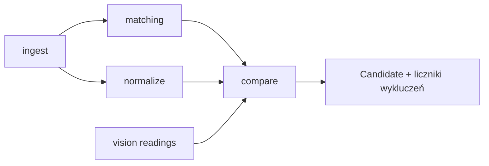
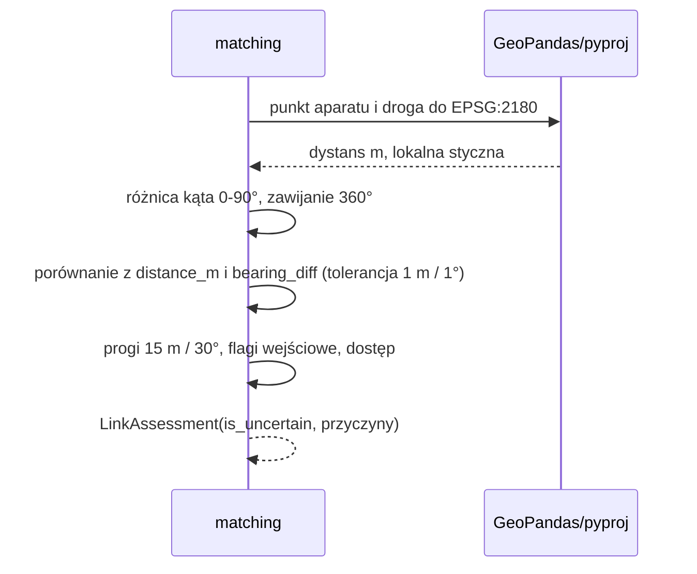
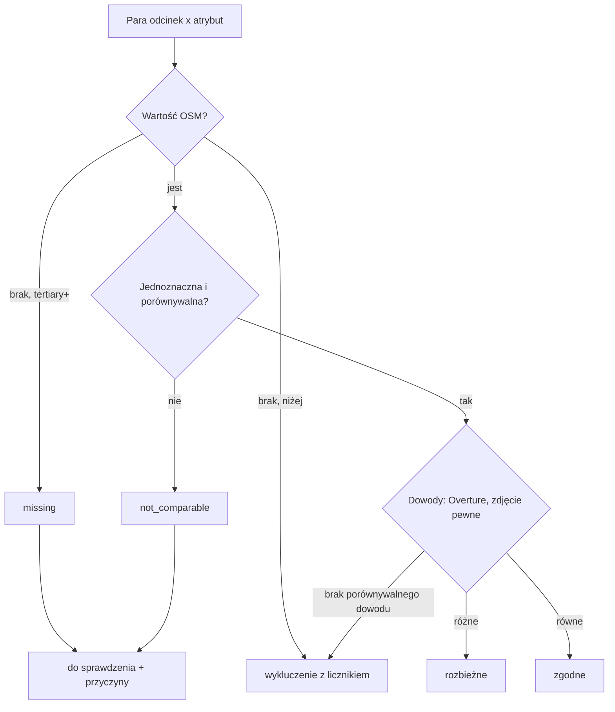

# ADR-001: Dane, normalizacja atrybutów i łączenie zdjęcia z drogą

**Data:** 2026-11-03
**Status:** Accepted
**Relates to:** [000-main-architecture.md](000-main-architecture.md), [PRD](../PRD.md) AC-01–AC-16
**Poprawki po audycie spójności 2026-11-12 (P1, P2, P6):** §3.1, §3.4, §3.5, §4.1, §4.3, §7, §8.

---

## 1. Zakres

Obejmuje moduły `ingest`, `normalize`, `matching`, `compare`: integralność wejść, CRS, normalizację `maxspeed*`, `speed_limits`, nawierzchni i `lit`, ocenę połączeń zdjęcie–droga oraz nadawanie kategorii i przyczyn. Nie obejmuje odczytu zdjęć modelem (ADR-002) ani raportu i dashboardu (ADR-003).

---

## 2. Dokumentacja technologii

| Biblioteka | Context7 ID lub dokumentacja | Użycie |
|---|---|---|
| geopandas 1.2.0 | `/geopandas/geopandas` | `read_parquet`, `to_crs`, `sjoin_nearest` (`max_distance`, `distance_col`) |
| shapely 2.2.0 | https://shapely.readthedocs.io/en/stable/ | `project`/`interpolate` do lokalnej stycznej |
| pyproj 3.8.0 | https://pyproj4.github.io/pyproj/stable/ | Transformacja punktów zdjęć |
| Overture transportation segment | https://docs.overturemaps.org/schema/reference/transportation/segment/ | Struktura `speed_limits`, `road_surface`, `sources` |
| OSM `maxspeed` | https://wiki.openstreetmap.org/wiki/Key:maxspeed | Formaty wartości, `:forward/:backward`, `:conditional` |

Uwaga z dokumentacji GeoPandas: `sjoin_nearest` zwraca kilka wierszy dla remisu i przecięć — wynik zawsze deduplikujemy regułą z §3.4. Wyniki w CRS geograficznym są niepoprawne, dlatego oba wejścia są w EPSG:2180 przed złączeniem.

Struktura reguł Overture opisana w §4.2 jest zgodna z dokumentacją schematu; przed pierwszym testem implementujący agent wypisuje typ kolumn `speed_limits`, `road_surface` i `sources` z `overture_segments.parquet` i zapisuje go w `reports/map-qa/profile.md`. Rozbieżność ze schematem → aktualizacja tego ADR, nie cicha adaptacja.

---

## 3. Projekt komponentów

### 3.1. `ingest`
- Dla każdego pliku z `sources.json` → `files` liczy rozmiar i SHA-256 przed wczytaniem. Niezgodność lub brak → wyjątek `InputIntegrityError(nazwa_pliku)` → CLI kod 1.
- Ten sam test powtarza się po zakończeniu runu, przed zmianą nazw plików raportu (AC-01); różnica → kod 1, komunikat z nazwą pliku i brak raportu (ADR-000 §6; poprawka 2026-11-12, wcześniej kod 3).
- `traffic_signs.geojson`: tylko kontrola integralności i liczność w raporcie (1 730); nie wpływa na pary ani kategorie (decyzja 2026-11-12, P6).
- OSM: `read_parquet`, CRS EPSG:4326. Overture: `read_parquet`, CRS OGC:CRS84. CRS ustawiany jawnie z `sources.json`, nie zgadywany; oba są w kolejności długość, szerokość.
- `tags` parsowane z JSON do słownika; surowy tekst JSON zachowany bez zmian w kolumnie `tags_raw`.
- `photos.csv`: `heading` pusty → brak (NaN), `0.0` → północ (AC-08). `is_panorama` przenoszone bez interpretacji.

### 3.2. CRS
- Wszystkie odległości i długości wyłącznie po `to_crs(2180)` obu warstw i punktów zdjęć (AC-04).
- Kierunki (bearing) liczone geodezyjnie względem północy rzeczywistej, zgodnie z regułą w `sources.json` → `links.bearing`: lokalna styczna drogi w promieniu ±5 m od rzutu aparatu w EPSG:2180, przeliczona na azymut geodezyjny.
- Zakaz: liczenie dystansu w stopniach; DuckDB `ST_Transform` bez `always_xy := true` (tylko profil).

### 3.3. Para porównania
- Jednostka wyniku: para (droga OSM `osm_id`, atrybut). Odpowiednik Overture to segment, którego `sources` zawiera `record_id` w formacie `w<osm_id>@<wersja>`; parser toleruje brak `@wersja` (4 przypadki w snapshocie). Profil 0b: 99 416 z 99 768 dróg ma odpowiednik.
- Jedna droga OSM ma 0..n segmentów Overture. 0 → porównanie OSM–Overture niemożliwe. n > 1 i różne znormalizowane wartości między segmentami → `not_comparable` (wartość dotyczy części drogi). n > 1 i jednakowe → jedna wartość.
- Dopasowanie Overture wyłącznie przestrzenne (bez `record_id`) nie tworzy pary OSM–Overture; jest tylko kandydatem zdjęcia i flagą niepewności.

### 3.4. `matching` — połączenie zdjęcie–droga
Punkt wyjścia: dostarczony `photo_road_links.csv` (dla `signs/` — `signs/nearest_osm.csv`). Nie liczymy połączeń od zera; walidujemy je i oznaczamy niepewność.

`signs/nearest_osm.csv` ma inny schemat (uzupełnienie 2026-11-12): `heading_diff_deg` odpowiada `bearing_diff`, `match_flags` odpowiada `candidate_flags`, brak `match_method`; kierunek aparatu to `compass_angle` w `signs/signs.csv`. Wiersze z `source = osm_api` (24, drogi spoza snapshotu, poza Krakowem) albo z flagą `outside_standard_25m` nie tworzą pary z mapą: zdjęcie służy tylko ewaluacji odczytu (ADR-002 §4.10). Pozostałe wiersze `signs/` przechodzą kroki 1–7 jak `photo_road_links.csv`. Zdjęcia `signs/` nie wchodzą do liczników AC-09 (te dotyczą 561 zdjęć z `photos.csv`).

1. Punkt aparatu → EPSG:2180; dystans do geometrii wskazanej drogi OSM w EPSG:2180. Różnica względem `distance_m` > 1,0 m → przyczyna `link_distance_mismatch`.
2. Lokalny kierunek drogi (§3.2) i różnica kątowa z `heading` jako minimum z obu kierunków geometrii, zakres 0–90°, z zawijaniem 360° (359° i 1° → 2°). Różnica względem `bearing_diff` > 1,0° → `link_bearing_mismatch`.
3. Połączenie jest niepewne (`is_uncertain = true`, przyczyna `ambiguous_link`), gdy zachodzi co najmniej jeden warunek:
   - dystans > 15 m (próg z `thresholds.toml`),
   - `bearing_diff` > 30° (próg z `thresholds.toml`),
   - flaga wejściowa `ambiguous_candidates`, `overture_spatial_only`, `service_way`, `panorama_heading_ambiguous`, `missing_heading`,
   - `match_method` = `spatial_fallback`,
   - `link_distance_mismatch` lub `link_bearing_mismatch`.
4. `match_method = none` lub flaga `no_osm_within_25m` → zdjęcie wykluczone z licznikiem „brak kandydata w promieniu” (PRD §4.4).
5. `camera_against_way_direction` i `boundary_crossing` są tylko informacją w raporcie — kierunek aparatu nie jest kierunkiem jazdy; nie oznaczają niepewności same w sobie.
6. Remisy: zachowujemy regułę wejściową (`distance_m + bearing_diff/9`, brak kierunku = 5 m; remis → dystans, potem `osm_id`). Jeśli implementacja liczy kandydata ponownie przez `sjoin_nearest` (tylko w teście walidacyjnym), deduplikacja tą samą regułą.
7. Drogi z `access` ∈ {`private`, `no`} lub `motor_vehicle` ∈ {`private`, `no`} → przyczyna `ambiguous_link` dla zdjęć z nimi połączonych (zdjęcie może przedstawiać sąsiednią drogę publiczną). Profil 0b: ok. 15 000 takich dróg (głównie `service`), 14 zdjęć z flagą `service_way`. Liczbę zdjęć połączonych z drogą o ograniczonym dostępie mierzy krok 3 i porównuje z wyzwalaczem D-103 (> 50%).
8. Liczniki AC-09 to trzy rozłączne grupy: pewne połączenie, niepewne połączenie (`ambiguous_link`), bez kandydata (krok 4); suma = 561.

### 3.5. `compare` — kategorie
Dla każdej pary zbieramy dowody: (a) OSM vs Overture, (b) OSM vs odczyt zdjęcia (tylko połączenie pewne i odczyt pewny). Przyczyny `ambiguous_link`, `abstain` i `model_unavailable` dotyczą wyłącznie dowodu (b); nie unieważniają dowodu (a) (decyzja 2026-11-12, P2). Reguła łączenia (kolejność obowiązuje):
1. Brak wartości OSM przy drodze `tertiary`+ → `do sprawdzenia` z `missing` (AC-13).
2. Jest co najmniej jedna przyczyna z listy `not_comparable`, `ambiguous_link`, `abstain`, `model_unavailable` dotycząca porównania, które byłoby jedynym dowodem pary → `do sprawdzenia` z wszystkimi przyczynami (AC-10, AC-10a).
3. Inaczej: dowolny porównywalny dowód z różnymi wartościami → `rozbieżne` (AC-11); OSM≠Overture przy obu wartościach porównywalnych daje `rozbieżne` także wtedy, gdy dowód ze zdjęcia jest niepewny lub go brak.
4. Inaczej: co najmniej jeden porównywalny dowód i wszystkie równe → `zgodne`.
5. Brak jakiegokolwiek porównywalnego dowodu (i brak przyczyny z pkt 1–2) → wykluczenie z licznikiem „brak porównywalnego dowodu” (AC-16), nie `zgodne` i nie kolejka ręczna (decyzja 2026-11-12, P1).

Zakres par:
- Etap 1, prędkość i nawierzchnia: wszystkie drogi OSM. Brak wartości OSM przy `highway` ∈ {motorway, trunk, primary, secondary, tertiary i `*_link`} → `missing` (AC-13). Drogi poniżej `tertiary` tworzą parę tylko przy porównywalnym dowodzie z Overture lub zdjęcia; brak wartości OSM poniżej `tertiary` → wykluczenie z licznikiem „brak wartości poniżej tertiary” (P1).
- Etap 2, oświetlenie i skrzyżowanie: tylko drogi połączone ze zdjęciem, bo Overture nie ma `lit`, a skrzyżowanie oceniamy względem kadru. Run `--stage 2` zawiera też wszystkie pary etapu 1 (ADR-000 §6, P4).
- Każde wykluczenie ma powód i licznik (AC-16).

**Doprecyzowania implementacji (2026-11-12, bez zmiany decyzji):**
- „Poniżej `tertiary` para tylko przy porównywalnym dowodzie” obejmuje także przypadki z przyczyną (nieporównywalna wartość OSM lub Overture, `ambiguous_link`, `abstain`, `model_unavailable`): bez porównywalnego dowodu → wykluczenie „brak porównywalnego dowodu” z licznikiem. Dla `tertiary`+ obowiązują kroki 1–5 (AC-12, AC-07). Etap 2 (`lit`, skrzyżowanie) nie ma ograniczenia klasy — pary tylko dla dróg połączonych ze zdjęciem.
- Odczyt prędkości `none` (brak znaku B-33) i oświetlenia `no` (brak lampy) nie tworzą dowodu; `unreadable` i `unknown` → `abstain`.
- Oświetlenie: widoczna lampa przy `lit=no` → `do sprawdzenia` z `not_comparable` („lampa nie dowodzi działania instalacji”); przy braku `lit` → `missing`.
- Skrzyżowanie: każde zdjęcie drogi porównywane z mapą w swoim punkcie rzutu; wyniki zdjęć łączone kolejnością `rozbieżne` > `zgodne` > kolejka > wykluczenie (`compare.combine_results`).
- Kandydat ma `link_details` (dystans i różnica kierunku przeliczone w EPSG:2180, przyczyny, flagi informacyjne `camera_against_way_direction`, `boundary_crossing`) — §3.4 krok 5 (review R-A).
- Wynik na pełnych danych etapu 1: 434 pewne / 124 niepewne / 3 bez kandydata; 0% `link_*_mismatch` (D-101), 0% `restricted_access` (D-103); `not_comparable` 14,3% par prędkości (D-102 < 40%).

---

## 4. Struktury danych i normalizacja

### 4.1. OSM `maxspeed*` → `SpeedValue`
Wejście: wszystkie klucze tagów zaczynające się od `maxspeed`. Surowe pary klucz–wartość zawsze w `maxspeed_raw` (JSON).

| Surowa wartość | `kind` | `value_kmh` | Porównywalna |
|---|---|---|---|
| liczba całkowita, np. `50` | `numeric` | 50 | tak |
| liczba z jednostką `km/h` | `numeric` | liczba | tak |
| `mph`, `knots` | `other_unit` | — | nie → `not_comparable` |
| kilka wartości przez `;` | `multiple` | — | nie → `not_comparable` |
| `PL:urban`, `PL:rural`, `PL:motorway`, `PL:zone30` i inne `XX:*` | `implicit` | — | nie → `not_comparable` (profil 0b: w snapshocie `PL:*` występuje tylko w `maxspeed:type`, więc reguła w praktyce nie zadziała) |
| `none`, `signals`, `walk`, inny tekst | `special` | — | nie → `not_comparable` |
| pusty / brak klucza | `missing` | — | → `missing` lub wykluczenie (§3.5) |

Reguły kierunkowe i warunkowe:
- `maxspeed:forward` / `maxspeed:backward` — względem kolejności węzłów OSM; `oneway=-1` odwraca kierunek jazdy względem węzłów. Porównanie z Overture i zdjęciem tylko wtedy, gdy wartości w obu kierunkach są równe; inaczej `not_comparable` (kierunek aparatu nie wyznacza kierunku jazdy). Tylko jeden z tagów kierunkowych, bez `maxspeed` dla drugiego kierunku → `not_comparable` (uzupełnienie 2026-11-12).
- `maxspeed:conditional` obecny → `not_comparable` dla całej pary, z surową regułą w raporcie (AC-12).
- `maxspeed:type` i `maxspeed:hgv/bus/trailer` — zachowane w `maxspeed_raw`, nie wpływają na porównanie.

### 4.2. Overture `speed_limits` → lista `SpeedRule`
Każda reguła zachowana w całości w `speed_limits_raw` (JSON z wszystkimi polami, także `when` i `between`). Znormalizowana reguła: `max_kmh?`, `unit`, `has_when`, `between?`, `is_variable?`.

Porównywalna jest para tylko wtedy, gdy segment ma dokładnie jedną regułę z `max_speed` w `km/h`, bez `when`, z `between` pustym (cały segment) i bez zmiennego ograniczenia. Każdy inny przypadek → `not_comparable`. Nie wybieramy pierwszej reguły z listy.

### 4.3. Nawierzchnia
- OSM `surface` → `paved` dla {asphalt, concrete, concrete:plates, concrete:lanes, paved, paving_stones, sett, cobblestone, unhewn_cobblestone, chipseal, metal, wood}; `unpaved` dla {unpaved, gravel, fine_gravel, compacted, dirt, earth, ground, grass, mud, sand, pebblestone, rock, woodchips, grass_paver}. Inne wartości → `not_comparable`. Lista w `thresholds.toml`, wersjonowana. Dopasowanie dokładne po usunięciu spacji z brzegów, z rozróżnianiem wielkości liter: `paving_Stones`, `contrete:plates` i podobne → `not_comparable` (profil, decyzja 3; uzupełnienie 2026-11-12).
- Overture `road_surface`: zachowane w `road_surface_raw`; porównywalna jedna reguła bez `between`. Wartości w snapshocie (profil 0b): `paved`, `paving_stones`, `metal` → paved; `unpaved`, `gravel`, `dirt` → unpaved; `unknown` → `not_comparable`.
- Odczyt zdjęcia: `paved` / `unpaved` / `unknown` (ADR-002).

### 4.4. Oświetlenie i skrzyżowanie (etap 2)
- `lit`: `yes` / `no` / brak / inne (`automatic`, `24/7` → `yes`; reszta → `not_comparable`). Widoczna lampa przy `lit=no` lub braku `lit` → `do sprawdzenia` (`missing` albo dowód rozbieżny trafia do kolejki zgodnie z PRD §8). Brak lampy w kadrze nie jest dowodem `lit=no` — taki odczyt nie tworzy dowodu.
- Skrzyżowanie na mapie: węzeł z `node_ids` współdzielony przez ≥ 2 drogi (lub węzeł wewnętrzny o stopniu ≥ 3) w odległości ≤ 25 m od rzutu aparatu na drogę. `bridge`, `tunnel` lub `layer` ≠ 0 na drodze połączonej albo `boundary_crossing` z węzłem końcowym w tym promieniu → `not_comparable`.

### 4.5. Kontrakt wyjścia `compare`
Wiersz `Candidate` (ADR-000 §5.2) z polami: `osm_id`, `overture_ids` (lista), `attribute`, `osm_raw`, `overture_raw`, `osm_norm`, `overture_norm`, `photo_ids` (lista), `photo_reading?`, `osm_timestamp`, `overture_release`, `category`, `reasons` (lista), `reason_text` (po polsku).

---

## 5. Interfejsy

| Funkcja (konceptualnie) | Wejście | Wyjście | Błędy |
|---|---|---|---|
| `verify_inputs` | katalog danych, `sources.json` | lista plików z hashami | `InputIntegrityError` |
| `load_layers` | ścieżki | OSM, Overture, zdjęcia, połączenia | brak kolumny → błąd z nazwą kolumny |
| `parse_osm_speed` | słownik tagów | `SpeedValue` + kierunek | nigdy nie rzuca; nieznane → `special` |
| `parse_overture_speed` | lista reguł | lista `SpeedRule`, flaga porównywalności | nigdy nie rzuca |
| `assess_links` | połączenia, warstwy 2180, progi | `LinkAssessment` na zdjęcie | — |
| `build_candidates` | warstwy, oceny, odczyty | `Candidate` + liczniki wykluczeń | — |

---

## 6. Decyzje techniczne

### D-101: Dostarczone połączenia jako kandydaci, z walidacją
**Status:** Accepted · **Data:** 2026-11-03
**Context:** `photo_road_links.csv` ma opisany algorytm i hashe; ponowne liczenie od zera dubluje pracę i może dawać inne remisy.
**Decision:** Używamy dostarczonych kandydatów; przeliczamy dystans i kierunek w EPSG:2180 tylko jako walidację (§3.4 kroki 1–2).
**Rejected alternatives:** własne `sjoin_nearest` dla wszystkich zdjęć — więcej kodu bez wymogu w PRD.
**Consequences:** (+) mniej kodu, zgodność z danymi. (−) błąd metody źródłowej przejdzie, jeśli walidacja go nie wykryje.
**Review trigger:** > 5% zdjęć z `link_distance_mismatch` lub `link_bearing_mismatch`.

### D-102: Porównywalna jest tylko jednoznaczna wartość
**Status:** Accepted · **Data:** 2026-11-03
**Context:** `maxspeed` bywa tekstem, wieloma wartościami, warunkiem; Overture ma listy reguł z `when`/`between`.
**Decision:** Wszystko poza jedną liczbą w km/h dla całego odcinka i obu kierunków → `not_comparable`, z surowymi wartościami w wyniku. Brak wartości domyślnych dla `PL:*`.
**Rejected alternatives:** mapowanie `PL:urban` na 50 km/h — założenie prawne poza zakresem PRD; pierwsza reguła Overture — gubi warunki.
**Consequences:** (+) brak fałszywych rozbieżności. (−) więcej pozycji w kolejce ręcznej.
**Review trigger:** `not_comparable` > 40% par prędkości w etapie 1.

### D-103: Rozszerzona lista warunków niepewnego połączenia
**Status:** Accepted (PRD AC-06 zaktualizowane) · **Data:** 2026-11-03
**Context:** Dane mają flagi `service_way`, `panorama_heading_ambiguous`, `missing_heading`, których AC-06 nie wymienia; PRD §12 wymaga ostrożności przy drogach serwisowych i panoramach.
**Decision:** Flagi z §3.4 krok 3 oraz ograniczony dostęp (krok 7) dają `ambiguous_link`.
**Consequences:** (+) mniej wniosków ze zdjęć innej jezdni. (−) mniej pewnych dowodów ze zdjęć.
**Review trigger:** `ambiguous_link` obejmuje > 50% zdjęć w próbie.

---

## 7. Diagramy

### Komponenty

### Ocena połączenia

### Kategoria pary

---

## 8. Strategia testów

Testy pisane przed kodem; dane testowe to kopie kilku prawdziwych wierszy (`signs/signs.csv` + `signs/nearest_osm.csv` po `photo_id`, `photo_road_links.csv`, `osm_roads_sample.geojson`) w `app/tests/fixtures/rows/`, z notą o źródle i dacie. Formaty nieobecne w snapshocie (np. `30 mph`, `50;70`, `PL:urban` w `maxspeed`, `none`) testy jednostkowe czystych funkcji `normalize` podają jako jawnie syntetyczne wartości parametryzowane (uzupełnienie 2026-11-12).

| Scenariusz | Typ | Wejście | Oczekiwany wynik | Przypadki brzegowe |
|---|---|---|---|---|
| Hash wejścia | Integration | kopia pliku z 1 zmienionym bajtem | `InputIntegrityError` z nazwą pliku | brak pliku |
| CRS i dystans | Unit | punkt i odcinek w znanej odległości 10,0 m w EPSG:2180 | 10,0 ± 0,01 m po przeliczeniu z 4326 | Overture w CRS84 |
| Kąt z zawijaniem | Unit | heading 359°, droga 1° | różnica 2° | odwrócona geometria → ta sama różnica |
| Brak kierunku | Unit | `heading` pusty / `0.0` | brak → `missing_heading`; 0 → północ | NaN po wczytaniu CSV |
| Dwa bliskie odcinki | Unit | flaga `ambiguous_candidates` | `ambiguous_link` | remis rangi → dystans, potem `osm_id` |
| Droga serwisowa / dostęp | Unit | `service_way`, `access=private` | `ambiguous_link` | `motor_vehicle=no` |
| `maxspeed` formaty | Unit | `50`, `50 km/h`, `30 mph`, `50;70`, `PL:urban`, `none`, brak | wg tabeli §4.1 | spacje, wielkie litery |
| Kierunkowe i warunkowe | Unit | `maxspeed:forward=50`, `:backward=70`, `oneway=-1`; `maxspeed:conditional` | `not_comparable`, surowe wartości zachowane | równe forward/backward → porównywalne |
| Reguły Overture | Unit | 1 reguła bez `when`; 2 reguły; reguła z `when`; z `between` | porównywalny tylko przypadek 1 reguły bez `when`/`between`; pozostałe `not_comparable`; wszystkie reguły w `speed_limits_raw` | jednostka mph |
| Kategoria | Unit | OSM 50, Overture 50 / 70 / brak; zdjęcie przy połączeniu niepewnym jako jedyny dowód | `zgodne` / `rozbieżne` / `do sprawdzenia` + `ambiguous_link` | OSM 50, Overture 70 i niepewne zdjęcie → `rozbieżne`; brak porównywalnego dowodu → wykluczenie z licznikiem |
| Most / tunel | Unit | `bridge=yes` przy skrzyżowaniu | `not_comparable` | `layer=-1` |
| Liczniki wykluczeń | Integration | pełne pliki map-qa | suma rozłącznych grup (pewne + niepewne + bez kandydata) = 561 (AC-09) | 3 zdjęcia bez kandydata |

### Techniczne kryteria akceptacji
- **TAC-001-01:** Dla każdego wiersza wyniku `osm_raw` i `overture_raw` są identyczne (porównanie tekstowe JSON) z wartościami w plikach wejściowych.
- **TAC-001-02:** Żadna funkcja w `matching` i `compare` nie przyjmuje geometrii w CRS innym niż EPSG:2180 do liczenia dystansu — test podaje GeoDataFrame w 4326 i oczekuje błędu.
- **TAC-001-03:** Run na pełnych danych daje liczniki: 3 zdjęcia bez kandydata i ≥ 65 zdjęć z `ambiguous_link`.
- **TAC-001-04:** Dla segmentu Overture z ≥ 2 regułami `speed_limits` wynik nigdy nie ma kategorii `zgodne` ani `rozbieżne` w porównaniu OSM–Overture.
