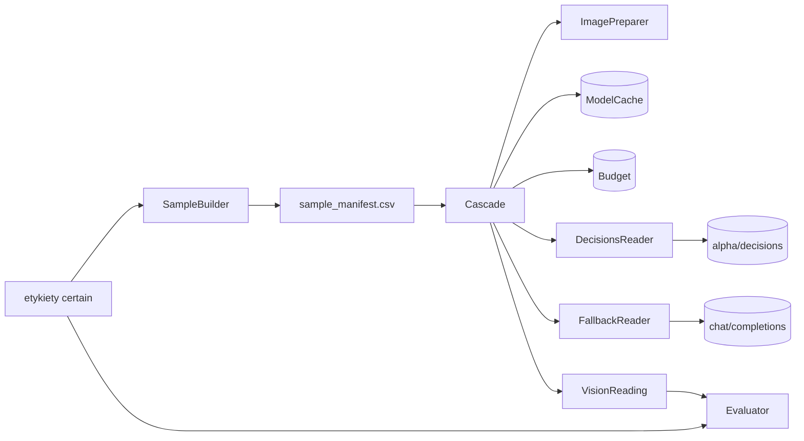
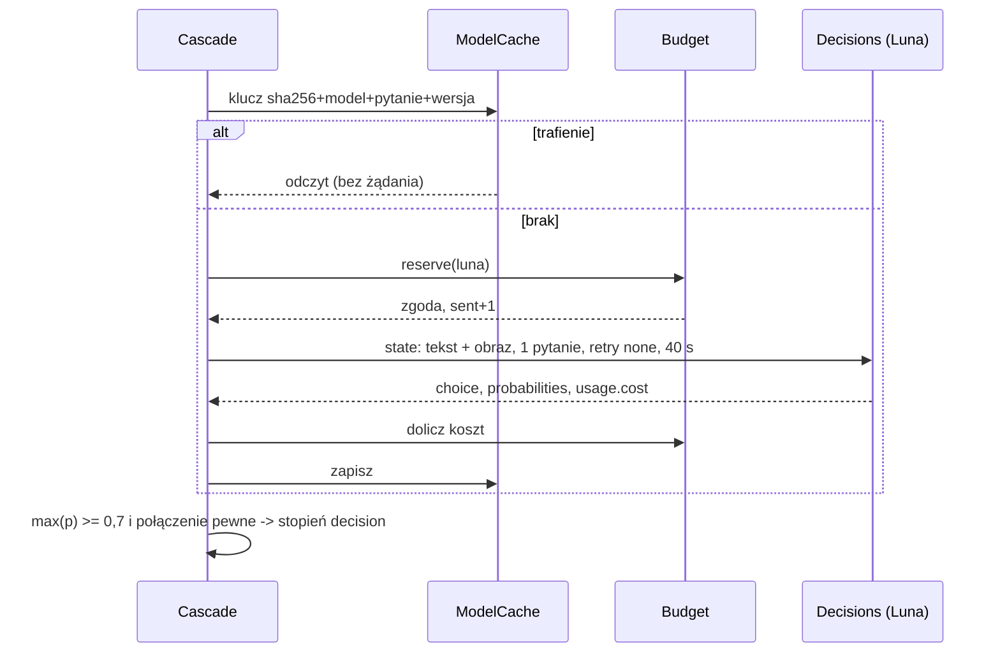
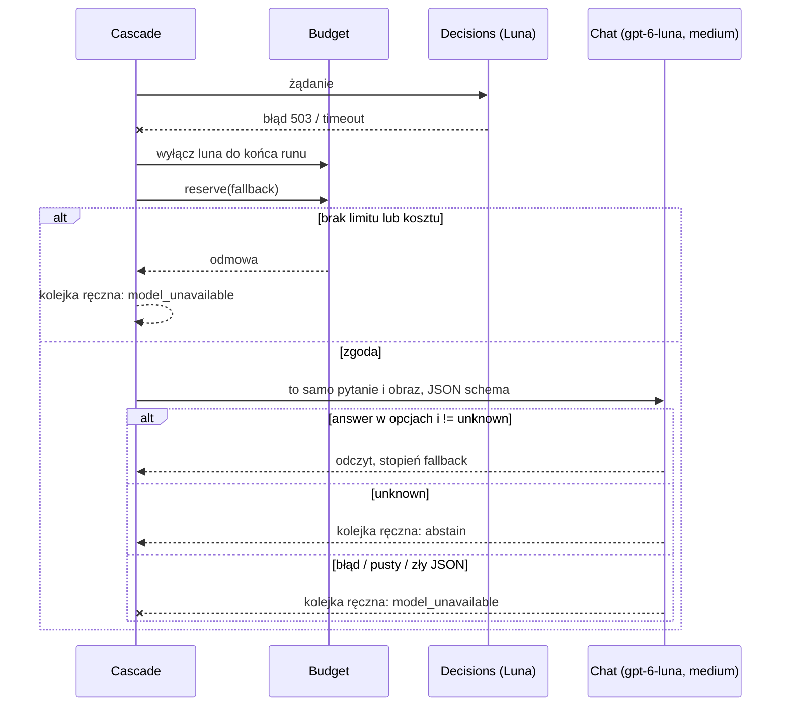
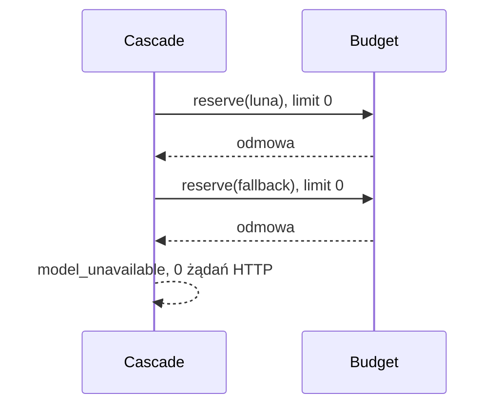

# ADR-002: Odczyt zdjęć modelami — Decisions, eskalacja, budżet i ewaluacja

**Data:** 2026-11-03
**Status:** Accepted
**Relates to:** [000-main-architecture.md](000-main-architecture.md), [PRD](../PRD.md) AC-17–AC-23, §11

---

## 1. Zakres

Moduły `vision` i `evaluation`: wybór próbki, przygotowanie obrazu, kontrakt OpenRouter Decisions (model główny i porównawczy), drugi stopień przez chat, limity żądań i kosztu, cache, capture odpowiedzi, mierzenie trafności. Nie obejmuje łączenia odczytu z mapą (ADR-001 §3.5).

---

## 2. Dokumentacja technologii

| Element | Context7 ID lub dokumentacja | Fakty zweryfikowane 2026-11-03 |
|---|---|---|
| Decisions API | https://openrouter.ai/docs/api/api-reference/alphadecisions/submit-a-decisions-request | `POST https://openrouter.ai/api/alpha/decisions`; wymagane `model`, `state`, `questions`; odpowiedź `answers`, `usage{input_tokens, output_tokens, cost}`; błędy 400–529 z `error{code,message,metadata}` |
| Obrazy w Decisions | https://openrouter.ai/docs/guides/community/multimodal-decisions | Część `state`: `image_url` z data URL (`data:image/jpeg;base64,…`); zdalne URL nie są pobierane; Jev: PNG/JPEG, bok 256–1568 px, ≤ 16 MiB |
| SDK Python | `/openrouterteam/python-sdk`; https://openrouter.ai/docs/client-sdks/python/sdks/decisions/README | Pakiet `openrouter==1.3.107`; `alpha.decisions.create(...)`, `chat.send(...)`; parametr `retries`; domyślnie backoff do 1 h |
| Reasoning | https://openrouter.ai/docs/use-cases/reasoning-tokens | `reasoning.effort` ∈ {…, `medium`, …}; reasoning dzieli budżet tokenów wyjścia z odpowiedzią |
| Structured outputs | https://openrouter.ai/docs/features/structured-outputs | `response_format` typu `json_schema` ze `strict: true` |
| Ceny | `GET https://openrouter.ai/api/v1/models/{id}/endpoints`; https://openrouter.ai/typesafe/jev-1.14, https://openrouter.ai/openai/gpt-6-luna-decisions | Jev 1.14 $0.042/M wejście, $0 wyjście, kontekst 262K; Luna Decisions $0.10/M wejście, $0 wyjście, kontekst 1.1M; oba multimodalne (obraz jako wejście); `openai/gpt-6-luna` $0.10/M wejście, $0.50/M wyjście |

**Do potwierdzenia przed kodem (nie zgadywać):** `timeout_ms` w `alpha.decisions.create`; nazwy argumentów konstruktora `OpenRouter`; położenie `provider.require_parameters` w `chat.send`; czy chat zwraca `usage.cost`; czy SDK udostępnia nagłówki odpowiedzi.

**Wynik weryfikacji SDK 1.3.107 (T5.2, 2026-11-12, kod zainstalowanego pakietu):**

| Pytanie | Wynik | Źródło |
|---|---|---|
| Konstruktor | `OpenRouter(api_key=, server_url=, client=, retry_config=, timeout_ms=)`; domyślny serwer `https://openrouter.ai/api/v1` | `openrouter/sdk.py`, `sdkconfiguration.py` |
| Retry | `RetryConfig("none", BackoffStrategy(...), False)`; per wywołanie `retries=`; domyślnie backoff do 1 h z ponawianiem błędów połączenia | `openrouter/utils/retries.py`, `decisions.py` |
| `timeout_ms` w `alpha.decisions.create` | **potwierdzony**, per wywołanie — D-03 bez zmian (surowy POST niepotrzebny) | `openrouter/decisions.py` |
| Pytanie `choice` | `{"type": "choice", "instructions": <tekst>, "criteria": {<opcja>: <opis lub null>}}` — opcje to klucze `criteria` | `components/decisionschoicequestion.py` |
| Obraz w Decisions | `state` = dowolny JSON (tekst, obiekt, lista); obraz jako część `image_url` albo przez mapę `assets` (`data_base64` bez prefiksu, `format`) z referencją w `state` | `components/decisionsrequest.py`, `decisionsimageasset.py` |
| Odpowiedź | `answers[qid].choice`, `.probabilities`, `.confidence`; `usage.cost` opcjonalne | `components/decisionsresponse.py`, `decisionschoiceanswer.py` |
| Chat | `chat.send(model, messages, reasoning, response_format, max_tokens, provider, retries, timeout_ms)`; `provider.require_parameters` w `ProviderPreferences`; `stream` domyślnie `False`; `usage.cost` opcjonalne | `openrouter/chat.py`, `components/chatrequest.py`, `providerpreferences.py`, `chatusage.py` |
| Nagłówki odpowiedzi | Metody zwracają model Pydantic bez nagłówków; dostęp przez własny `httpx.Client` (event hooks) przekazany jako `client=` | `openrouter/httpclient.py` |
| Transport testowy | `OpenRouter(client=httpx.Client(transport=httpx.MockTransport(...)))` — bez sieci | `openrouter/httpclient.py` |
| Błędy | klasy per status w `openrouter.errors` (np. `BadRequestResponseError`, `ServiceUnavailableResponseError`); timeout/połączenie = wyjątki `httpx` | `openrouter/decisions.py`, `errors/__init__.py` |

**Kontrakt połączenia (uzupełnienie 2026-11-12, decyzja użytkownika):** wszystkie trzy modele (`openai/gpt-6-luna-decisions`, `typesafe/jev-1.14`, `openai/gpt-6-luna`) są wywoływane **wyłącznie przez OpenRouter**: Decisions → `https://openrouter.ai/api/alpha/decisions`, chat → `https://openrouter.ai/api/v1/chat/completions` (przez SDK `openrouter`, domyślny serwer SDK; `server_url` nie jest konfigurowalny z CLI ani `thresholds.toml`). Jedynym kluczem jest `OPENROUTER_API_KEY` czytany z `os.environ` (zmienna ustawiona na poziomie użytkownika); aplikacja nie czyta `.env`, nie używa `OPENAI_API_KEY` ani klienta OpenAI. Test jednostkowy sprawdza, że skonfigurowany klient wskazuje host `openrouter.ai`, a capture (§4.5) zapisuje rzeczywisty URL endpointu.

---

## 3. Projekt komponentów

| Komponent | Odpowiedzialność |
|---|---|
| `SampleBuilder` | Buduje `sample_manifest.csv` przed pierwszym żądaniem |
| `ImagePreparer` | Bajty obrazu do wysłania i ich SHA-256 |
| `Budget` | Limity żądań i kosztu na model, trwały licznik w SQLite |
| `ModelCache` | Odczyt i zapis odpowiedzi po kluczu |
| `DecisionsReader` | Model główny i porównawczy przez `alpha.decisions.create` |
| `FallbackReader` | Drugi stopień przez `chat.send` |
| `Cascade` | Kolejność: cache → główny → drugi stopień → kolejka ręczna |
| `Evaluator` | Trafność i pokrycie na etykietach `certain` |

Stan runu: tylko SQLite (`budget_ledger`, `model_cache`) i pliki runu. Brak stanu w pamięci między runami.

---

## 4. Kontrakty i struktury danych

### 4.1. Pytania (`questions_version = 1`, w `thresholds.toml`)
Typ pytania: `choice`. Jedno pytanie w jednym żądaniu (PRD AC-19a). Wersja 1 obejmuje wszystkie cztery pytania; etap 2 używa tej samej `questions_version = 1`, bez podnoszenia wersji (decyzja 2026-11-12, P5). Teksty po angielsku, neutralne, bez nazw miejsc, identyfikatorów i danych mapy.

| `question_id` | Etap | Opcje (`criteria`) | Znaczenie |
|---|---|---|---|
| `speed_limit_value` | 1 | `5`, `10`, `20`, `30`, `40`, `50`, `60`, `70`, `80`, `90`, `100`, `110`, `120`, `130`, `140`, `none`, `unreadable`, `unknown` | Wartość okrągłego znaku zakazu B-33; `none` — brak takiego znaku (także znak strefy lub końca ograniczenia); `unreadable` — znak bez czytelnej wartości |
| `surface` | 1 | `paved`, `unpaved`, `unknown` | Paved = asfalt, beton, kostka |
| `street_lighting_visible` | 2 | `yes`, `no`, `unknown` | Rozpoznawalna oprawa lampy ulicznej; sam słup nie wystarcza |
| `junction_visible` | 2 | `yes`, `no`, `unknown` | Widoczne połączenie lub rozdzielenie dróg dla pojazdów; nie przejście dla pieszych ani wiadukt |

Zmiana tekstu lub opcji → `questions_version + 1` (unieważnia cache, AC-22).

### 4.2. Żądanie Decisions
- `model`: główny `typesafe/jev-1.14`, porównawczy `openai/gpt-6-luna-decisions` (ADR-000 D-04, zmiana 2026-11-12); wartości z `thresholds.toml` (`decision_model`, `comparison_model`).
- `state`: tablica dokładnie dwóch części: tekst „Street-level photograph. Answer about what is visible.” i obraz jako data URL JPEG. Nic więcej (PRD AC-17): bez nazwy pliku, `photo_id`, etykiet, detekcji, atrybutów mapy, współrzędnych.
- `questions`: mapa z jednym kluczem `question_id`.
- `provider`: `allow_fallbacks = false` (bez cichej zmiany dostawcy w trakcie próby).
- Bez `session_id`, `user`, `trace`.
- Wywołanie: retry strategii `none`, timeout 40 s.

**Potwierdzone capture T5.2b (2026-11-12):** `state` = [część tekstowa, część `image_url` z data URL JPEG] jest przyjmowany przez Jev i Luna Decisions (HTTP 200); niepoprawne `criteria` (pusty słownik) → HTTP 422 (nie 400). Pytanie `choice` w SDK: `{"type": "choice", "instructions", "criteria": {opcja: opis}}`.

### 4.3. Odpowiedź i interpretacja
- Odczyt: `answers[question_id].choice`, `.probabilities`, `.confidence`; `usage.cost`.
- **Pewny** odczyt modelu głównego: `choice` ∈ opcje, `choice` ≠ `unknown`, max(`probabilities`) ≥ próg `abstain_threshold` (start 0,7, AC-20a) i połączenie zdjęcia pewne (ADR-001 §3.4).
- Inaczej → eskalacja (§4.4). Błąd HTTP / wyjątek SDK / timeout → model główny wyłączony do końca runu (AC-20), pytanie eskaluje.
- Model porównawczy (domyślnie Luna Decisions) nie wpływa na kategorie ani eskalację; jego wynik trafia tylko do tabeli porównania.

### 4.4. Drugi stopień (`chat.send`)
- `model`: `openai/gpt-6-luna`; `reasoning.effort = medium`; limit tokenów wyjścia z `thresholds.toml` (start 1024).
- Wiadomość użytkownika: ten sam neutralny tekst + tekst pytania z listą opcji + ten sam obraz (data URL). Bez promptu systemowego z danymi.
- `response_format`: JSON Schema `strict` z jednym polem `answer` o wartości z listy opcji pytania (z `unknown`); dostawca musi obsługiwać parametry (`require_parameters`).
- **Pewny** odczyt: poprawny JSON, `answer` ∈ opcje, ≠ `unknown`. Niepewność sygnalizuje wyłącznie `unknown` — bez samooceny liczbowej.
- `unknown` → kolejka ręczna, przyczyna `abstain`. Pusta lub ucięta odpowiedź, JSON niezgodny ze schematem, błąd, timeout, brak limitu → `model_unavailable` (AC-20d). Pewna odpowiedź nie usuwa `ambiguous_link` (PRD AC-07).
- Każdy niepewny odczyt eskaluje najwyżej raz (AC-20b).
- Niepoprawna treść odpowiedzi drugiego stopnia (zły JSON, odpowiedź spoza listy) → `model_unavailable` dla tej pary, **bez** wyłączania modelu; model wyłącza tylko błąd żądania (HTTP, timeout, wyjątek SDK) — AC-20 (doprecyzowanie 2026-11-12).
- Zdjęcia `signs/` bez pary z mapą (`evaluation_only`) nie mają warunku połączenia w AC-20a (brak połączenia ≠ połączenie niepewne).

### 4.5. Capture i mock
- Pierwsze rzeczywiste żądanie dla każdej pary (endpoint, model) — osobne zadanie capture przed implementacją `vision` (plan orkiestracji T5.2b; przydział prowadzącego 2026-11-12) — jest zapisywane w `app/tests/fixtures/captures/<data>_<model>.json` **zanim** powstanie jakikolwiek mock.
- Zawartość: data UTC, endpoint, wersja SDK, model, status HTTP, nagłówki z listy dozwolonej (`content-type`, `date`, identyfikator żądania; inne odrzucone; jeśli SDK nie udostępnia nagłówków — pole z adnotacją „niedostępne przez SDK”), pełne ciało odpowiedzi, treść żądania z obrazem zastąpionym przez `sha256` i rozmiar.
- Przed zapisem: test odrzuca plik, jeśli zawiera nagłówek `authorization`, ciąg `sk-or-` albo wartość zmiennej `OPENROUTER_API_KEY`.
- Mocki w testach jednostkowych i integracyjnych zwracają wyłącznie ciała z capture (ewentualnie z podmienioną jedną wartością opisaną w teście). Bez capture → testy integracyjne modelu są pomijane z jawnym powodem, nie zastępowane wymyśloną odpowiedzią. Testy manualne i E2E nie używają mocków: wywołują prawdziwe endpointy (uzupełnienie 2026-11-12, polecenie prowadzącego).

### 4.6. Obraz
- Źródło: pełny kadr. Zdjęcia `signs/photos/` (prędkość), `offline/` lub `data/photos/` po `download_photos.py --verify-only` (pozostałe). Zdjęcie bez lokalnego pliku z poprawnym SHA-256 nie wchodzi do próbki.
- Najdłuższy bok > 1568 px → zmniejszenie proporcjonalne do 1568 px (Pillow 12.0.0, LANCZOS, JPEG quality 90). Bez wycinania. Mniejsze obrazy — bajty bez zmian. Najkrótszy bok < 256 px albo format inny niż JPEG/PNG → zdjęcie poza próbką z licznikiem (wymaganie Jev jako modelu głównego, 2026-11-12).
- Klucz cache i logi używają `image_sha256` wysłanych bajtów; base64 nigdy nie trafia do logów, raportu ani capture.

### 4.7. Próbka (`sample_manifest.csv`)
- Jednostka: para (zdjęcie, pytanie) z etykietą `certain` dla tego pytania: prędkość z `signs/labels.csv` (`sign_value`), pozostałe z `reference_labels.csv`.
- Podział walidacja/test po `sequence`: SHA-256 identyfikatora sekwencji, parzysty pierwszy bajt → walidacja, nieparzysty → test.
- Kolejność: pary posortowane po SHA-256 (`photo_id` + `question_id`); pytania etapu naprzemiennie, aż do limitu żądań modelu głównego. Etap 1 przy limicie 25: 13 par prędkości + 12 nawierzchni.
- Model porównawczy: pierwsze `comparison-limit` pary z manifestu, które zostały już wysłane do modelu głównego (PRD AC-19); po wyłączeniu modelu głównego (AC-20) model porównawczy nie dostaje nowych par (uzupełnienie 2026-11-12).
- Kolumny: `photo_id`, `question_id`, `split`, `sequence`, `image_sha256`, `order`. Plik zapisany i zsynchronizowany na dysk przed pierwszym żądaniem; nie zmienia się w trakcie runu.
- Etykiety referencyjne są używane tylko przez `SampleBuilder` (wybór) i `Evaluator`; nie trafiają do żadnego komponentu, który buduje żądanie.

### 4.8. Budżet i koszt
- Limity z CLI (ADR-000 §6): główny ≤ 25, porównawczy ≤ 5, drugi stopień ≤ 10, domyślnie 0; `--max-cost-usd` wspólne dla wszystkich modeli.
- Przed każdym żądaniem `Budget` w jednej transakcji SQLite: sprawdza, czy `sent < limit`, model nie jest wyłączony i `cost_sum + reserve ≤ max_cost`; zwiększa `sent`. Dopiero potem żądanie. Żądanie nieudane pozostaje policzone (AC-19).
- `reserve` z `thresholds.toml` (start 0,01 USD na żądanie). Po odpowiedzi `cost_sum += usage.cost`; brak `cost` w odpowiedzi → doliczenie `reserve`.
- Odmowa budżetu → odczyt `model_unavailable`, bez żądania.
- Cache hit nie zwiększa licznika.

**Uzupełnienie po capture T5.2b (2026-11-12):** konto OpenRouter działa w trybie BYOK — `usage.cost` bywa 0, a rzeczywisty koszt jest w `usage.cost_details.upstream_inference_cost`. Koszt żądania liczony jako `max(usage.cost, upstream_inference_cost)`; brak obu → `reserve`. Rezerwa wchodzi tylko do sprawdzenia przed żądaniem i zastępuje koszt wyłącznie przy jego braku.

### 4.9. Cache
- Klucz: `image_sha256` + `model` + `question_id` + `questions_version` (AC-22). Wartość: znormalizowany odczyt i pełne ciało odpowiedzi bez sekretów.
- Zapisywane są tylko odpowiedzi poprawne (także `unknown` i niepewne); błędów nie cache'ujemy.

### 4.10. Ewaluacja (`evaluation`)
- Dla każdego pytania i podziału: liczba par, pokrycie = pewne odczyty / pary, trafność = poprawne pewne odczyty / pewne odczyty, osobno dla modelu głównego, po eskalacji i dla modelu porównawczego.
- Raport zawiera liczbę wykluczonych etykiet `uncertain` (AC-23) i liczbę odczytów rozstrzygniętych przez każdy stopień (AC-20e).
- Model porównawczy: pokrycie i trafność liczone tylko na parach, które faktycznie dostał; ponowny run z cache odtwarza jego odczyty bez żądań (2026-11-12).
- **Próba 2026-11-12 (T6):** limity 25/5/10, 40 żądań, 0 błędów, 0,006367 USD; ponowny run 0 żądań. Prędkość: pokrycie 1,0, trafność 0,769 (próg 0,8 niespełniony; 2 z 3 niezgodności to etykiety z wycinka znaku innego niż B-33, a na pełnym kadrze widać inny znak B-33 — ryzyko z PRD §12); nawierzchnia: pokrycie 1,0, trafność 1,0. Progi nie zostały zmienione po próbie (AC-23).
- **Próba etapu 2 (2026-11-13):** `--stage 2`, limity 25/5/10: 25 nowych żądań (reszta z cache), 0 błędów, 0,0032 USD. Oświetlenie: pokrycie 1,0, trafność 0,833 (próg spełniony); skrzyżowanie: pokrycie 1,0, trafność 0,333 (próg niespełniony; 6 par — bez wniosków o modelach, PRD §12). Ryzyko: pytanie `junction_visible` nie ogranicza odległości, a mapa jest sprawdzana w promieniu 25 m — model odpowiada „yes” dla odległego odgałęzienia (Manual QA `panoramax_c92cd930…`). Rozważyć `questions_version = 2` z ograniczeniem do najbliższego otoczenia aparatu.
- Zdjęcie próbki jest odrzucane, gdy SHA-256 pliku różni się od manifestu (`photos.csv`/`signs.csv`, kolumna `sha256`); pominięte pary są licznikiem wykluczeń „próbka modelu: …” (review R-F).
- Progi akceptacji zapisane w `thresholds.toml` i zatwierdzone commitem przed runem z przydziałem; raport zapisuje hash commitu pliku progów.

---

## 5. Interfejsy

| Interfejs | Wejście | Wyjście | Błędy |
|---|---|---|---|
| `build_sample(stage, limits)` | etykiety, zdjęcia lokalne | manifest | brak zdjęć → pusty manifest i ostrzeżenie |
| `prepare_image(path)` | plik JPEG | bajty, `sha256`, wymiary | plik uszkodzony → para wykluczona z licznikiem |
| `Budget.reserve(model)` | model | zgoda / odmowa | — |
| `read(photo, question)` | para z manifestu | `VisionReading(stage, answer, probs, reason)` | nigdy nie przepuszcza wyjątku API dalej |

---

## 6. Decyzje techniczne

### D-201: Pytanie `choice` z progiem na prawdopodobieństwie
**Status:** Accepted · **Data:** 2026-11-03
**Context:** Abstencja wymaga liczbowej miary pewności z modelu.
**Decision:** `choice` z jawnymi opcjami i `unknown`; próg na max(`probabilities`).
**Rejected alternatives:** `score` — wartości znaku nie są skalą; `noul` — tylko tak/nie, wymagałby wielu pytań na jedną wartość.
**Consequences:** (+) jeden mechanizm dla czterech pytań. (−) próg 0,7 nieskalibrowany na tak małej próbie.
**Review trigger:** pokrycie na walidacji < 30% lub > 95%.
**Wyzwalacz zadziałał (próby 2026-11-12/13):** pokrycie 1,0 dla wszystkich pytań (model decyzyjny zwraca prawdopodobieństwa bliskie 1); przegląd progu `abstain_threshold` i sposobu abstencji — decyzja człowieka przed kolejną wersją pytań.

### D-202: Retry wyłączone, timeout 40 s, wyłączenie modelu po błędzie
**Status:** Accepted · **Data:** 2026-11-03
**Context:** Domyślne retry SDK (backoff do 1 h) łamie limit żądań i kosztu.
**Decision:** Retry `none` w każdym wywołaniu; timeout 40 s; pierwszy błąd wyłącza dany model do końca runu.
**Consequences:** (+) liczba żądań = liczba prób. (−) przejściowy błąd 429/503 kończy pracę modelu w runie.
**Review trigger:** SDK ignoruje konfigurację retry (test z capture błędu 503).

### D-203: Drugi stopień sygnalizuje niepewność tylko przez `unknown`
**Status:** Accepted · **Data:** 2026-11-03
**Context:** Chat nie zwraca prawdopodobieństw opcji; samoocena LLM bywa źle skalibrowana.
**Decision:** Structured output z zamkniętą listą; `unknown` = abstencja.
**Rejected alternatives:** pole pewności 0–1 — brak kalibracji, pozorna precyzja.
**Consequences:** (+) prosty kontrakt. (−) model może zbyt rzadko odpowiadać `unknown`.
**Review trigger:** trafność drugiego stopnia na walidacji niższa niż modelu głównego.

### D-204: Próbka par (zdjęcie, pytanie)
**Status:** Accepted (PRD AC-19a/AC-19c zaktualizowane) · **Data:** 2026-11-03
**Context:** Etykiety prędkości (`signs/`) i nawierzchni (`reference_labels.csv`) dotyczą różnych zdjęć; jedno zdjęcie rzadko ma pewne etykiety obu pytań etapu.
**Decision:** Próbka to pary (zdjęcie, pytanie); limit żądań = limit par.
**Consequences:** (+) wykorzystuje oba zbiory etykiet. (−) brak porównania wielu pytań na tym samym zdjęciu.
**Review trigger:** pojawią się etykiety `certain` dla wszystkich pytań etapu na tych samych zdjęciach.

---

## 7. Diagramy

### Komponenty

### Odczyt pewny z cache lub modelu głównego

### Eskalacja i kolejka ręczna

### Run bez budżetu

---

## 8. Strategia testów

Kolejność pracy w etapie M6: testy walidacji, limitu, cache i abstencji (Red) → minimum kodu (Green) → jedno rzeczywiste żądanie na parę (endpoint, model) i capture (przydział prowadzącego 2026-11-12) → dopiero potem testy oparte na mocku z capture → mała próba.

| Scenariusz | Typ | Wejście | Oczekiwany wynik | Przypadki brzegowe |
|---|---|---|---|---|
| Treść żądania | Unit | para z manifestu | `state` ma 2 części; brak `photo_id`, nazwy pliku, etykiety, współrzędnych w serializowanym żądaniu | `photo_id` w nazwie pliku obrazu |
| Limit 0 | Unit | domyślne limity | 0 wywołań transportu; odczyt `model_unavailable` | `--max-cost-usd 0` |
| Limit z błędami | Unit | limit 3, transport: błąd, OK, OK, OK | 3 wywołania łącznie; czwarte odmówione | przerwany run i wznowienie — licznik z SQLite |
| Wyłączenie po błędzie | Unit | pierwszy wynik 503 | brak kolejnych żądań do Luny; eskalacja do drugiego stopnia | 429, timeout |
| Brak retry w SDK | Integration | lokalny serwer HTTP odpowiadający 503 | dokładnie 1 żądanie | błąd połączenia |
| Próg abstencji | Unit | probabilities max 0,69 / 0,70 | eskalacja / pewny | `choice` spoza opcji, `unknown` |
| Połączenie niepewne | Unit | pewny odczyt + `ambiguous_link` | eskalacja; kategoria końcowa `do sprawdzenia` | — |
| Drugi stopień | Unit (mock z capture) | `unknown`; zły JSON; pusta odpowiedź | `abstain`; `model_unavailable`; `model_unavailable` | limit 0 |
| Cache | Unit | drugi run, ten sam obraz i wersja pytań | 0 żądań, `cache_hit = true` | zmiana `questions_version` → nowe żądanie |
| Obraz | Unit | JPEG 1600×900 | 1568×882, nowy `sha256` | obraz 1024 px bez zmian |
| Próbka | Unit | etykiety z 2 sekwencji | cała sekwencja w jednym podziale; manifest zapisany przed żądaniem | etykieta `uncertain` pominięta |
| Capture bez sekretów | Unit | capture z nagłówkiem `authorization` | zapis odrzucony | ciąg `sk-or-` w ciele |
| Ewaluacja | Unit | 4 pary, 3 pewne, 2 poprawne | pokrycie 0,75, trafność 0,67 | 0 pewnych → trafność „brak danych”, nie 0 |
| Rzeczywista próba | E2E (prawdziwe API, bez mocków; przydział ≤ 1 USD) | `--decision-limit 1` | 1 żądanie, capture zapisany, koszt w raporcie | brak klucza → `model_unavailable`, kod 0 |

### Techniczne kryteria akceptacji
- **TAC-002-01:** Licznik `sent` w `budget_ledger` po runie równa się liczbie żądań zarejestrowanych przez transport testowy, dla każdego modelu.
- **TAC-002-02:** Żaden plik w katalogu runu, logach i capture nie zawiera ciągu `base64,`.
- **TAC-002-03:** Raport zawiera łączny koszt USD z `usage.cost` i liczbę żądań każdego modelu; koszt ≤ `--max-cost-usd`.
- **TAC-002-04:** Każdy mock w `app/tests/` wskazuje plik capture, z którego pochodzi.
