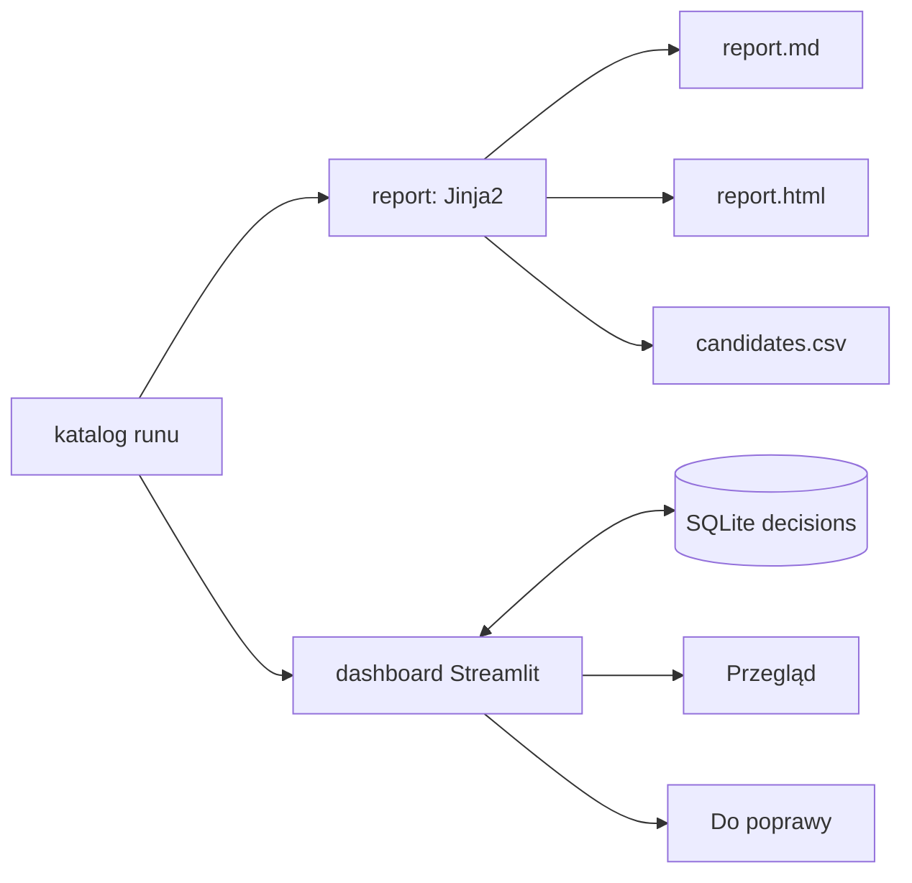
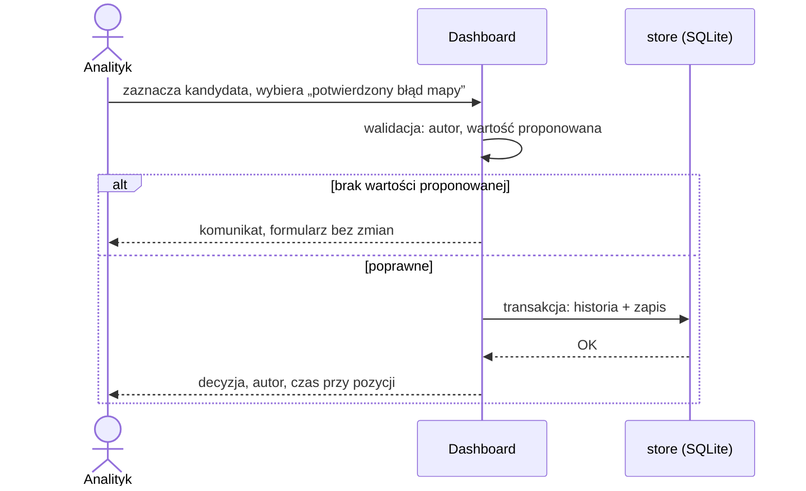
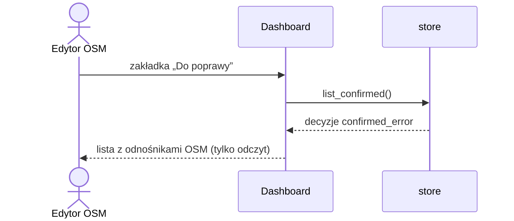

# ADR-003: Raport i dashboard

**Data:** 2026-11-03
**Status:** Accepted
**Relates to:** [000-main-architecture.md](000-main-architecture.md), [PRD](../PRD.md) AC-24–AC-30, §9

---

## 1. Zakres

Moduły `report` i `store` oraz `dashboard/app.py`: raport Markdown/HTML/CSV, aplikacja Streamlit z zakładkami „Przegląd” i „Do poprawy”, trwały zapis decyzji. Nie obejmuje obliczania kandydatów (ADR-001) ani odczytów (ADR-002).

---

## 2. Dokumentacja technologii

| Biblioteka | Context7 ID lub dokumentacja | Użycie |
|---|---|---|
| jinja2 3.1.6 | https://jinja.palletsprojects.com/en/stable/api/#autoescaping | Szablony `report.md.j2`, `report.html.j2`; autoescape tylko dla HTML |
| streamlit 1.66.1 | `/streamlit/docs`; https://docs.streamlit.io/develop/api-reference/data/st.dataframe | `st.dataframe(on_select="rerun", selection_mode="single-row")`, `st.tabs`, `st.form` |
| sqlite3 | https://docs.python.org/3.12/library/sqlite3.html | Tabele `decisions`, `runs` |
| Playwright CLI | https://playwright.dev/docs/test-cli | E2E i Manual QA |

Z dokumentacji Streamlit: `st.data_editor` nie ma zaznaczania wierszy — wybór kandydata realizujemy przez `st.dataframe` z `on_select`. Niezweryfikowane: szczegóły `st.form` i `st.cache_data` w 1.66 — sprawdzić przed kodem.

---

## 3. Projekt komponentów

### 3.1. Raport (`report`)
- Wejście: `candidates.parquet`, `readings.parquet`, `run.json` (liczności, wersje źródeł, CRS, limity, koszty, ograniczenia, liczniki wykluczeń, metryki).
- Wyjście w katalogu runu: `report.md`, `report.html`, `candidates.csv` (UTF-8 z BOM dla Excela, separator `,`).
- Lista szczegółowa w MD, HTML i CSV: wszystkie pary `rozbieżne` i `do sprawdzenia`, ta sama liczba wierszy we wszystkich trzech (AC-24). Pary `zgodne` tylko w tabeli podsumowania i w `candidates.parquet`.
- Kolejność listy: kategoria (`rozbieżne`, potem `do sprawdzenia`), atrybut, `osm_id`.
- Miniatura: względna ścieżka do lokalnego pliku zdjęcia z podpisem: autor, licencja, odnośnik do źródła (AC-25). Brak pliku → tekst „Zdjęcie niedostępne” z atrybucją.
- Odnośnik OSM: `https://www.openstreetmap.org/way/<osm_id>`.
- Teksty po polsku; identyfikatory i surowe tagi bez tłumaczenia.
- HTML: jeden plik, bez zewnętrznych skryptów i fontów; wszystkie wartości z danych przez autoescape (tagi OSM są niezaufanym tekstem).

### 3.2. Zapis decyzji (`store`)
- Tabela `decisions`: `candidate_key` (osm_id, overture_ids posortowane, atrybut) jako klucz główny, `decision` ∈ {`confirmed_error`, `no_error`, `uncertain`}, `proposed_value?`, `comment`, `author`, `decided_at` (UTC ISO 8601), `run_id`.
- Ponowny zapis tego samego klucza nadpisuje decyzję; poprzednia wersja trafia do `decisions_history` (pełny ślad).
- `confirmed_error` wymaga niepustej `proposed_value` (PRD §4.3); brak → błąd walidacji w formularzu, nic nie jest zapisane.
- Każdy zapis w transakcji; tryb WAL.

### 3.3. Dashboard (`dashboard/app.py`)
- Start: `uv run streamlit run dashboard/app.py` z `app/`; serwer tylko na `localhost`; telemetria Streamlit wyłączona w `app/.streamlit/config.toml` (`browser.gatherUsageStats = false`).
- Wczytuje najnowszy katalog z `reports/map-qa/runs/` (po `run_id`) i decyzje z SQLite.
- Pole „Autor” na pasku bocznym, zapamiętane w stanie sesji; wymagane przed zapisem decyzji.
- **Zakładka „Przegląd”:** filtry atrybut / kategoria / etap / przyczyna; licznik pozycji; tabela `st.dataframe` z zaznaczeniem jednego wiersza; panel szczegółów (wartości obu źródeł z datami, zdjęcie z atrybucją, stan połączenia, odczyt i stopień lub „brak odczytu modelu”, przyczyny); formularz: decyzja (3 opcje), wartość proponowana, komentarz, „Zapisz”.
- **Zakładka „Do poprawy”:** tylko `confirmed_error`; kolumny: odnośnik OSM, obecna wartość, wartość proponowana, zdjęcie z atrybucją, komentarz, autor, czas. Tylko odczyt.
- Stany: brak runów → „Brak wyników kontroli — uruchom kontrolę z wiersza poleceń”; brak potwierdzonych → „Brak potwierdzonych przypadków”; błąd zapisu → komunikat, wpisana treść zostaje w formularzu.
- Dashboard nie wykonuje żadnych żądań sieciowych poza serwerem lokalnym (AC-30): zdjęcia tylko z plików lokalnych.

---

## 4. Struktury danych

| Plik / tabela | Zawartość |
|---|---|
| `run.json` | `run_id`, etap, czas, wersje źródeł (OSM `extract_date`, Overture `release`), `questions_version`, hash commitu `thresholds.toml`, CRS, liczności wejść, liczniki wykluczeń po powodach, sekcja ograniczeń, limity i wykorzystanie żądań, koszt, metryki ewaluacji |
| `candidates.csv` | Kolumny `Candidate` (ADR-001 §4.5) z listami jako tekst JSON |
| `decisions` | §3.2 |
| `decisions_history` | Kopie nadpisanych decyzji z czasem nadpisania |

---

## 5. Interfejsy

| Interfejs | Wejście | Wyjście | Błędy |
|---|---|---|---|
| `write_report(run_dir)` | pliki runu | 3 pliki raportu | brak pliku runu → wyjątek, CLI kod 3, brak częściowego raportu (zapis do plików tymczasowych i zmiana nazwy na końcu) |
| `save_decision(...)` | klucz, decyzja, wartość, komentarz, autor | zapisany wiersz | walidacja → komunikat; błąd SQLite → komunikat bez utraty danych formularza |
| `list_confirmed()` | — | decyzje `confirmed_error` z danymi kandydata z najnowszego runu | kandydat nieobecny w runie → wiersz z adnotacją „brak w bieżącym runie” |

---

## 6. Decyzje techniczne

### D-301: Jinja2 dla raportu
**Status:** Accepted · **Data:** 2026-11-03
**Context:** Raport HTML zawiera tekst z tagów OSM i nazw ulic — niezaufane dane.
**Decision:** Jinja2 z autoescape dla HTML; ten sam model danych dla szablonu MD.
**Rejected alternatives:** czysty Python (f-stringi) — ręczne escapowanie łatwo pominąć; generatory statycznych stron — nadmiar.
**Consequences:** (+) bezpieczny HTML, oddzielony układ. (−) jedna dodatkowa zależność.
**Review trigger:** raport potrzebuje interaktywnych wykresów.

### D-302: Streamlit dla dashboardu
**Status:** Accepted · **Data:** 2026-11-03
**Context:** Etap 3: jeden użytkownik lokalnie, filtry, formularz, dwie zakładki; QA na VM bez pulpitu deweloperskiego.
**Decision:** Streamlit 1.66.1, `st.dataframe` z zaznaczeniem wiersza, formularz zapisu.
**Rejected alternatives:**
- PySide6 6.12.0: pełna kontrola UI, ale więcej kodu i trudniejsze automatyczne QA.
- Statyczny HTML + plik decyzji: zapis decyzji z przeglądarki wymagałby własnego serwera.
**Consequences:** (+) mało kodu, testy przez Playwright CLI. (−) model „rerun całego skryptu” wymaga ostrożnego stanu formularza.
**Review trigger:** praca wielu analityków lub > 10 tys. kandydatów w tabeli spowalnia UI powyżej 2 s.

### D-303: Decyzja wiązana z kluczem kandydata, nie z runem
**Status:** Accepted · **Data:** 2026-11-03
**Context:** Analityk kontynuuje przegląd po kolejnym runie (PRD historia 4).
**Decision:** Klucz (osm_id, overture_ids, atrybut) bez `run_id`; `run_id` zapisany informacyjnie.
**Consequences:** (+) decyzje przetrwają nowe runy. (−) zmiana danych źródłowych przy tym samym kluczu może unieważnić decyzję — dashboard pokazuje datę decyzji i run, w którym zapadła.
**Review trigger:** nowe wydanie snapshotu.

---

## 7. Diagramy

### Komponenty

### Zapis decyzji

### Widok edytora

---

## 8. Strategia testów

| Scenariusz | Typ | Wejście | Oczekiwany wynik | Przypadki brzegowe |
|---|---|---|---|---|
| Spójność formatów | Integration | run z 7 kandydatami (3 `zgodne`) | MD, HTML, CSV mają po 4 pozycje | 0 pozycji → komunikat stanu pustego |
| Escapowanie | Unit | tag `name` = `` | w HTML jako tekst, nie znacznik | znaki `&`, `"` |
| Atrybucja | Unit | kandydat ze zdjęciem | autor, licencja, odnośnik obecne | brak pliku → „Zdjęcie niedostępne” |
| Brak częściowego raportu | Integration | błąd przy zapisie HTML | żaden z 3 plików nie istnieje | — |
| Trwałość decyzji | Integration | zapis, zamknięcie połączenia, ponowne otwarcie | decyzja z autorem i czasem | nadpisanie → wpis w historii |
| Walidacja | Unit | `confirmed_error` bez wartości proponowanej | błąd, brak zapisu | pusty autor |
| Dashboard Przegląd | E2E (Playwright CLI) | prawdziwy run etapu 1 | filtr „rozbieżne” pokazuje liczbę równą raportowi; zapis decyzji widoczny po przeładowaniu | stan pusty bez runów |
| Do poprawy | E2E (Playwright CLI) | 1 decyzja `confirmed_error` | 1 wiersz z odnośnikiem `openstreetmap.org/way/` | 0 decyzji → komunikat |
| Brak sieci | E2E | dashboard z przechwyceniem żądań w Playwright | brak żądań poza `localhost` | — |

### Techniczne kryteria akceptacji
- **TAC-003-01:** Liczba wierszy listy w `report.md`, `report.html` i `candidates.csv` jest równa dla każdego runu testowego.
- **TAC-003-02:** E2E dashboardu kończy się zrzutami ekranu obu zakładek, bez błędów w konsoli przeglądarki i z polskimi tekstami interfejsu.
- **TAC-003-03:** Po restarcie serwera Streamlit decyzja zapisana przed restartem jest widoczna w obu zakładkach zgodnie z jej typem.
