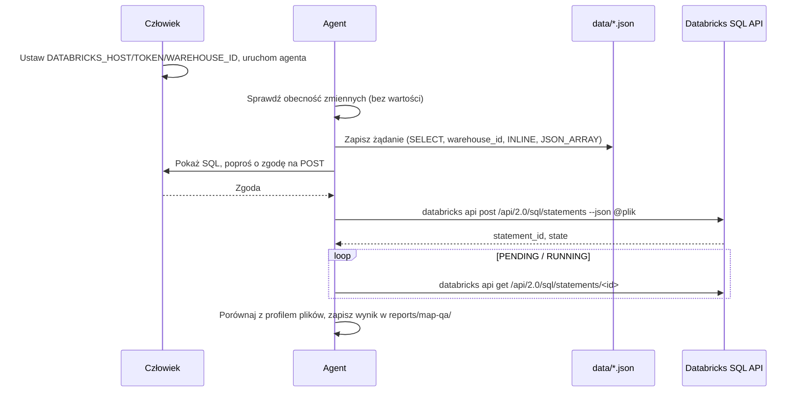

# ADR-004: Databricks CLI jako narzędzie agentów do kontroli danych

**Data:** 2026-11-12
**Status:** Accepted
**PRD:** [docs/PRD.md](../PRD.md) — AC-03, AC-05, §8 „Dane wejściowe” (tabele chmurowe)
**Powiązane:** [ADR-000](000-main-architecture.md) D-02 (bez zmian), [profil danych](../../reports/map-qa/profile.md), instrukcja ćwiczenia `course-materials/exercise-data/map-qa/DATABRICKS.md`

---

## 1. Kontekst

- Profil danych (krok 0b) potwierdził liczności i schemat plików lokalnych, ale nie porównał ich z tabelami `workspace.map_qa`, bo w sesji nie było tokenu (profil, „Ograniczenia”).
- ADR-000 D-02 odrzucił Databricks CLI **jako zależność aplikacji**: komenda `map-qa compare-counts` używa `urllib`. Ta decyzja zostaje.
- Ćwiczenie M2 wymaga, aby **agent** (Claude Code lub Codex) odczytał tabele, porównał liczności i wykonał kontrole przestrzenne. Do tego potrzebne jest narzędzie deweloperskie z kontrolą uprawnień, a nie nowa zależność aplikacji.
- Wspólny token prowadzącego ma zakres API `sql`. Zakres nie ogranicza SQL do odczytu, bo obowiązują uprawnienia właściciela tokenu. Za tryb tylko-do-odczytu odpowiada więc agent i reguły uprawnień.

### 1.1. Dane w Databricks (z DATABRICKS.md i profilu)

| Tabela | Wiersze (plik = tabela?) | Uwagi dla zapytań |
|---|---:|---|
| `workspace.map_qa.osm_roads` | 99 768 | `geometry` to **BINARY WKB** → `ST_GeomFromWKB(geometry, 4326)` |
| `workspace.map_qa.overture_segments` | 85 405 | `speed_limits`, `road_surface`, `sources` zagnieżdżone (lista STRUCT) |
| `workspace.map_qa.photos` | 561 | punkt: `ST_Point(longitude, latitude, 4326)`; 15 zdjęć bez `heading` |
| `workspace.map_qa.photo_road_links` | 561 | kandydaci połączeń, nie prawda; `distance_m` do porównania |
| `workspace.map_qa.traffic_signs` | 1 730 | brak pliku liczonego w profilu; etap 1 |

Dystanse wyłącznie po `ST_Transform(..., 2180)` (PRD AC-04). Metadane GeoParquet nie zastępują jawnego SRID.

---

## 2. Decyzje

### D-401: Databricks CLI jako narzędzie agenta, nie aplikacji
**Status:** Accepted · **Data:** 2026-11-12
**Decision:** Agenci używają oficjalnego Databricks CLI (instalacja `winget install Databricks.DatabricksCLI`; zweryfikowano v1.26.0 na VM 2026-11-12) do zapytań przez SQL Statement Execution API: `databricks api post /api/2.0/sql/statements` z plikiem żądania JSON i `databricks api get /api/2.0/sql/statements/<id>` do odpytywania. Alternatywnie `course-materials/exercise-data/map-qa/query_databricks.py`, który sam odpytuje ten sam `statement_id`. Kod w `app/` nie importuje i nie wywołuje CLI.
**Rejected alternatives:**
- Stary pakiet Python `databricks-cli`: przestarzały, inna składnia.
- Managed MCP (`/ai-gateway/mcp-services/system.ai.dbsql`): wspólny token `sql` dostaje HTTP 403; tylko jako rozszerzenie z osobnym dostępem (DATABRICKS.md).
- Databricks SQL Connector w `app/`: nowa zależność wbrew D-02.
**Consequences:** (+) agent wykonuje M2 bez nowego kodu aplikacji; jedno narzędzie dla Claude Code i Codex. (−) CLI jest instalowany osobno na każdej VM; wynik zależy od działania warehouse.
**Review trigger:** aplikacja musi czytać tabele chmurowe w pipeline (wtedy nowy ADR zamiast D-02).

### D-402: Tylko `SELECT`, żądanie z pliku, bez automatycznego ponawiania
**Status:** Accepted · **Data:** 2026-11-12
**Decision:**
1. Agent wysyła wyłącznie `SELECT` (także `WITH … SELECT`). Zakazane: `CREATE`, `INSERT`, `UPDATE`, `DELETE`, `MERGE`, `DROP`, `ALTER`, `GRANT`, `COPY`, `OPTIMIZE` i tworzenie zasobów workspace.
2. Treść żądania jest w pliku `course-materials/exercise-data/map-qa/data/*.json` (katalog `data/` jest w `.gitignore` danych). Plik nie zawiera tokenu ani hosta.
3. Stan `PENDING`/`RUNNING` → tylko `GET` dla tego samego `statement_id`. Nowy `POST` tego samego SQL jest zabroniony, dopóki poprzedni nie ma stanu końcowego.
4. `FAILED`/`CANCELED` to błąd, nie pusty wynik.
5. Zapytania przestrzenne kontrolują dane wejściowe; nie są dowodem błędu mapy (PRD §7).
**Consequences:** (+) koszt warehouse ograniczony, wynik odtwarzalny z pliku żądania. (−) dwa kroki zamiast jednego polecenia.

### D-403: Sekrety tylko w zmiennych środowiskowych ustawianych przez człowieka
**Status:** Accepted · **Data:** 2026-11-12
**Decision:** `DATABRICKS_HOST`, `DATABRICKS_TOKEN`, `DATABRICKS_SQL_WAREHOUSE_ID` ustawia człowiek w terminalu, z którego uruchamia agenta. Agent sprawdza tylko obecność zmiennych (np. `[ -n "$DATABRICKS_TOKEN" ] && echo set`), nigdy wartości. Zakazane dla agenta: `databricks auth env`, `databricks auth token`, `databricks auth describe`, `databricks configure`, `env`, `printenv`. `databricks current-user me` uruchamia człowiek (odpowiedź zawiera dane tożsamości).
**Fallback dla Codex:** Codex filtruje zmienne środowiskowe przekazywane do poleceń (`shell_environment_policy`; wzorzec domyślny wyklucza nazwy z `*TOKEN*`, a zachowanie domyślne zależy od wersji). Jeśli w Codex polecenie kończy się błędem uwierzytelnienia mimo ustawionych zmiennych, człowiek tworzy profil w `~/.databrickscfg` (`databricks configure --profile map-qa`, poza repozytorium), a agent używa `--profile map-qa`. Nie wyłączamy globalnie filtra sekretów w `.codex/config.toml`.
**Consequences:** (+) token nie trafia do rozmowy, plików repo ani Git. (−) każda nowa sesja terminala wymaga ponownego ustawienia zmiennych.

### D-404: Reguły uprawnień agentów
**Status:** Accepted · **Data:** 2026-11-12

| Polecenie | Claude Code (`.claude/settings.json`) | Codex (`.codex/rules/course.rules`) |
|---|---|---|
| `databricks version`, `databricks --version`, `databricks --help` | allow | domyślnie (sandbox) |
| `databricks api get …` | allow (odczyt statusu i wyniku) | domyślnie (sandbox) |
| `databricks api post …` | ask (każde SQL do akceptacji) | prompt |
| `uv run … query_databricks.py …` | ask | domyślnie — *uwaga:* reguła prefiksowa nie rozróżnia skryptu po `uv run`; zgoda zależy od `approval_policy` |
| `databricks api put/patch/delete …` | deny | forbidden |
| `databricks auth env/token/describe`, `databricks configure` | deny | forbidden |
| `databricks current-user …` | ask | prompt |

**Consequences:** (+) agent może sam odpytać status i wynik, ale człowiek widzi każde SQL przed wysłaniem. (−) reguły prefiksowe nie analizują treści pliku JSON; zgoda na `post` wymaga przeczytania pliku żądania.

---

## 3. Przepływ kontroli w M2

---

## 4. Testy akceptacyjne

- **TAC-004-01:** `databricks version` w nowym terminalu zwraca wersję ≥ 1.26.0.
- **TAC-004-02:** Zapytanie licznościowe pięciu tabel (DATABRICKS.md, „Sprawdź liczności”) daje 99 768 / 85 405 / 561 / 561 / 1 730; rozbieżność → wpis w `reports/map-qa/profile.md` i decyzja przed krokiem 1.
- **TAC-004-03:** Kontrola geometrii: `invalid = 0` dla OSM i Overture.
- **TAC-004-04:** Ponowne obliczenie dystansu zdjęcie–droga w EPSG:2180: `max_difference_m` ≤ 0,01 m względem `photo_road_links.distance_m`.
- **TAC-004-05:** `git grep -n -I "dapi"` oraz wyszukanie wartości tokenu w `reports/` i `course-materials/exercise-data/map-qa/data/` dają 0 trafień.
- **TAC-004-06:** Próba `databricks auth env` przez agenta jest zablokowana (Claude: deny, Codex: forbidden).

---

## 5. Otwarte kwestie

- Czy domyślny filtr Codex przepuszcza `DATABRICKS_TOKEN` na tej wersji (0.167.2) — sprawdzić pierwszym zapytaniem; wynik dopisać tutaj.
- `traffic_signs` nie ma liczności z profilu plików; porównanie 1 730 z `traffic_signs.geojson` do dopisania w profilu.
- Instalacja dodaje `databricks` do PATH dopiero w nowym terminalu; sesja agenta uruchomiona wcześniej go nie widzi.
