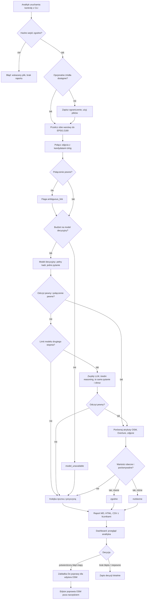

# PRD — Kontrola mapy: drogi OSM i Overture a zdjęcia ulic Krakowa

---

## 1. Podsumowanie

Prototyp (PoC) narzędzia dla analityka map QA i edytora OSM. Narzędzie zestawia drogi OpenStreetMap i segmenty Overture ze zdjęciami ulic Krakowa i wskazuje odcinki, które warto sprawdzić ręcznie: brakujące atrybuty, rozbieżności między źródłami i niepewne połączenia zdjęcia z drogą. Zdjęcie pomaga odczytać widoczne cechy. Narzędzie nie rozstrzyga automatycznie o błędzie mapy; decyzję podejmuje człowiek, a poprawkę w OSM wykonuje edytor poza narzędziem.

---

## 2. Problem

- Atrybuty dróg (ograniczenie prędkości, nawierzchnia, oświetlenie, skrzyżowania) w OSM i Overture bywają puste, różne albo nieaktualne. Analityk nie wie, od których odcinków zacząć.
- Overture częściowo pochodzi ze starszego OSM, a źródła mają różne daty. Sama rozbieżność wartości lub liczby segmentów nie oznacza błędu.
- Zdjęcia ulic leżą obok mapy, ale bez połączenia z konkretnym odcinkiem. Pozycja aparatu nie jest pozycją znaku, a kierunek aparatu nie jest kierunkiem jazdy. Ręczne szukanie zdjęcia dla odcinka i porównywanie wartości zajmuje dużo czasu.
- Dziś analityk musi ręcznie przeszukiwać tagi, otwierać zdjęcia w serwisach źródłowych i notować wnioski poza jakimkolwiek wspólnym rejestrem. Edytor OSM nie ma jednego miejsca z potwierdzonymi przypadkami.

---

## 3. Użytkownicy / persony

### Analityk map QA
- Uruchamia kontrolę dla obszaru Krakowa i przegląda listę kandydatów.
- Przy każdym kandydacie widzi wartości z OSM i Overture, daty źródeł, zdjęcie z atrybucją i odczyt zdjęcia.
- Zapisuje decyzję: „potwierdzony błąd mapy”, „brak błędu” albo „niepewne”, z komentarzem.
- Oczekuje, że każdą pozycję da się odtworzyć z danych wejściowych i że narzędzie nie ukrywa wykluczonych rekordów.

### Edytor OSM
- Otwiera w dashboardzie widok przypadków potwierdzonych przez analityka.
- Potrzebuje identyfikatora drogi OSM, odnośnika do obiektu, obecnej i proponowanej wartości, zdjęcia z autorem i licencją oraz uzasadnienia analityka.
- Poprawkę w OSM wykonuje sam, w swoim narzędziu edycji. Oczekuje, że narzędzie niczego nie wysyła do OSM.

---

## 4. Główne przepływy

### 4.1. Uruchomienie kontroli (happy path)
1. Analityk uruchamia kontrolę z wiersza poleceń, wskazując etap i opcjonalnie limit wywołań modelu.
2. System wczytuje lokalny snapshot danych (drogi OSM, segmenty Overture, manifest zdjęć, kandydaci połączeń, znaki) i sprawdza jego zgodność z zapisanymi rozmiarami i hashami.
3. System przelicza geometrię obu warstw do metrycznego układu EPSG:2180 przed liczeniem odległości.
4. System łączy zdjęcia z kandydatami dróg i oznacza połączenia niepewne według progów z sekcji 8.
5. System porównuje atrybuty objęte bieżącym etapem i nadaje każdej parze jedną z kategorii: `zgodne`, `rozbieżne`, `do sprawdzenia`.
6. Jeśli przydzielono budżet, system wysyła pełne kadry zdjęć z próbki do modelu odczytu, osobnym żądaniem dla każdego pytania, i zapisuje odczyt widocznych cech.
7. System zapisuje raport Markdown i HTML oraz eksport CSV, z podsumowaniem liczbowym i licznikami wykluczeń.
8. System kończy pracę z komunikatem o liczbie kandydatów w każdej kategorii i ścieżką raportu.

### 4.2. Przegląd w dashboardzie
1. Analityk otwiera dashboard na wyniku ostatniej kontroli.
2. Filtruje listę po atrybucie, kategorii i etapie.
3. Otwiera kandydata: widzi wartości obu źródeł z datami, zdjęcie z atrybucją, odczyt modelu (jeśli był) i powód trafienia na listę.
4. Wybiera decyzję i wpisuje komentarz. System zapisuje decyzję lokalnie z autorem i czasem.
5. Po ponownym otwarciu dashboardu decyzje są widoczne.

### 4.3. Widok edytora OSM
1. Edytor otwiera zakładkę „Do poprawy”.
2. Widzi tylko przypadki z decyzją „potwierdzony błąd mapy”.
3. Dla każdego widzi identyfikator i odnośnik do drogi w OSM, obecną wartość, wartość proponowaną przez analityka, zdjęcie z atrybucją i komentarz.
4. Poprawkę wykonuje poza narzędziem.

### 4.4. Ścieżki alternatywne
- **Niepewny odczyt — eskalacja dwustopniowa:** gdy model decyzyjny jest niepewny, nie odpowiada (błąd API) albo dotyczy zdjęcia z niepewnym połączeniem, system raz przekazuje to samo pytanie i obraz do zwykłego modelu językowego ze średnim poziomem rozumowania. Jeśli i on nie da pewnej odpowiedzi, przypadek trafia do kolejki ręcznej analityka z przyczyną.
- **Brak budżetu:** system nie wywołuje żadnego modelu; pary, w których odczyt zdjęcia byłby jedynym dowodem, trafiają do kolejki ręcznej z przyczyną `model_unavailable`. Brak odczytu nie zmienia kategorii wynikającej z porównania OSM–Overture (ADR-001 §3.5; decyzja 2026-11-12).
- **Databricks lub API niedostępne:** system zapisuje to ograniczenie w raporcie i kontynuuje na lokalnych plikach.
- **Niezgodny hash pliku wejściowego:** system przerywa kontrolę z komunikatem wskazującym plik; nie nadpisuje wejść.
- **Brak kandydata drogi dla zdjęcia:** zdjęcie jest liczone jako wykluczone z powodem „brak kandydata w promieniu”; to stan danych, nie błąd mapy.
- **Wartość nieporównywalna** (reguła warunkowa `when`/`between`, kilka wartości, inna jednostka, dotyczy części odcinka, most lub tunel): para dostaje kategorię `do sprawdzenia`, a surowe wartości są zachowane.

---

## 5. Historyjki użytkownika

1. Jako analityk chcę uruchomić jedną komendą kontrolę wybranego etapu, aby dostać listę kandydatów z powodem trafienia na listę.
2. Jako analityk chcę widzieć obok siebie wartości OSM i Overture z datami źródeł, aby ocenić, czy rozbieżność wynika z różnicy snapshotów.
3. Jako analityk chcę widzieć zdjęcie połączone z odcinkiem i informację, czy połączenie jest pewne, aby nie wyciągać wniosków ze zdjęcia innej jezdni.
4. Jako analityk chcę zapisać decyzję i komentarz, które przetrwają zamknięcie dashboardu, aby kontynuować przegląd następnego dnia.
5. Jako analityk chcę, aby przy braku budżetu lub błędzie modelu raport nadal powstał, z jawnie oznaczonymi pozycjami bez odczytu.
6. Jako analityk chcę widzieć liczniki wykluczonych rekordów z powodami, aby wiedzieć, czego raport nie obejmuje.
7. Jako edytor OSM chcę widzieć tylko potwierdzone przypadki z proponowaną wartością i zdjęciem, aby szybko wykonać poprawkę.
8. Jako lider zespołu (odbiorca raportu) chcę znać trafność odczytu zdjęć na etykietach referencyjnych, aby wiedzieć, na ile ufać odczytom modelu.

---

## 6. Kryteria akceptacji

### Dane wejściowe
- **AC-01:** Po kontroli pliki wejściowe mają te same rozmiary i hashe SHA-256 co przed kontrolą.
- **AC-02:** Przy niezgodnym hashu pliku wejściowego kontrola kończy się kodem błędu, a komunikat zawiera nazwę pliku; raport nie powstaje.
- **AC-03:** Raport podaje liczność wczytanych dróg OSM, segmentów Overture i zdjęć; dla dostarczonego snapshotu są to 99 768, 85 405 i 561.
- **AC-04:** Wszystkie odległości w raporcie są w metrach, liczone po przeliczeniu obu warstw do EPSG:2180; raport podaje użyty układ.
- **AC-05:** Gdy Databricks lub API są niedostępne, raport zawiera sekcję „Ograniczenia” z nazwą źródła i przyczyną, a kontrola kończy się sukcesem na plikach. Kontrola nie odpytuje Databricks (ADR-000 D-02), więc sekcja zawsze zawiera wpis o Databricks i stan dostępu do modelu.

### Połączenia zdjęcie–droga
- **AC-06:** Połączenie jest oznaczone jako niepewne, gdy spełniony jest co najmniej jeden warunek: dystans > 15 m, różnica kierunku > 30°, flaga alternatywnych kandydatów, dopasowanie Overture wyłącznie przestrzenne (bez referencji do OSM), droga serwisowa, panorama bez jednoznacznego kierunku, brak kierunku aparatu, droga z dostępem ograniczonym (`access` lub `motor_vehicle` = `private`/`no`), niezgodność przeliczonego dystansu lub kierunku z danymi wejściowymi.
- **AC-07:** Para z niepewnym połączeniem nigdy nie dostaje kategorii `rozbieżne` na podstawie zdjęcia; gdy zdjęcie jest jej jedynym dowodem, dostaje `do sprawdzenia` z przyczyną `ambiguous_link`, także gdy odczyt zdjęcia jest pewny. Różnica OSM–Overture przy obu wartościach porównywalnych pozostaje `rozbieżne` (ADR-001 §3.5; decyzja 2026-11-12).
- **AC-08:** Brak kierunku aparatu jest traktowany jako brak, a `heading = 0` jako kierunek północny; raport podaje liczbę zdjęć bez kierunku.
- **AC-09:** Raport podaje liczbę zdjęć w trzech rozłącznych grupach: z pewnym połączeniem, z połączeniem niepewnym i bez kandydata drogi; suma równa się liczbie zdjęć.

### Porównanie atrybutów
- **AC-10:** Każda porównana para (odcinek, atrybut) ma dokładnie jedną kategorię: `zgodne`, `rozbieżne` albo `do sprawdzenia`. Każda pozycja `do sprawdzenia` trafia do kolejki ręcznej i ma co najmniej jedną przyczynę z zamkniętej listy: `missing`, `not_comparable`, `ambiguous_link`, `abstain`, `model_unavailable`.
- **AC-10a:** Pozycja z kolejki ręcznej nigdy nie dostaje automatycznie kategorii `zgodne` ani `rozbieżne`; zmienia ją tylko decyzja analityka.
- **AC-11:** Kategoria `rozbieżne` jest nadawana tylko wtedy, gdy obie porównywane wartości są obecne, jednoznaczne i porównywalne, a różnią się.
- **AC-12:** Wartości warunkowe, wielokrotne, z jednostką inną niż km/h, dotyczące części odcinka lub mostu/tunelu dostają `do sprawdzenia`, a raport pokazuje je w surowej postaci.
- **AC-13:** Brak atrybutu w OSM dla drogi klasy `tertiary` lub wyższej (z łącznikami `*_link`) dostaje `do sprawdzenia` z adnotacją „brak atrybutu”.
- **AC-14:** Żadna pozycja raportu ani dashboardu nie nosi etykiety „błąd mapy” bez decyzji analityka.
- **AC-15:** Każdy kandydat w raporcie zawiera: identyfikator OSM, identyfikator Overture (jeśli jest), surowe wartości obu źródeł, daty źródeł, powód kategorii i identyfikator zdjęcia (jeśli jest).
- **AC-16:** Raport podaje liczniki wykluczonych rekordów pogrupowane według powodu; żaden rekord nie jest usuwany bez licznika. Para bez porównywalnego dowodu (OSM–Overture ani zdjęcia) jest wykluczeniem z licznikiem, nie kategorią `zgodne` ani pozycją kolejki ręcznej; wyjątek: brak atrybutu z AC-13 (decyzja 2026-11-12).

### Odczyt zdjęć modelem
- **AC-17:** Model otrzymuje wyłącznie neutralny tekst pytania i obraz; nie otrzymuje nazw plików, identyfikatorów, etykiet referencyjnych, detekcji Mapillary ani atrybutów mapy.
- **AC-18:** Odpowiedź modelu jest jedną wartością z zamkniętej listy dla pytania (np. wartość B-33, `none`, `unreadable`); odpowiedź spoza listy jest traktowana jako niepewny odczyt.
- **AC-19:** Liczba wszystkich żądań do modelu w jednej próbie, łącznie z nieudanymi, nie przekracza 25 dla modelu podstawowego i 5 dla modelu porównawczego; żądanie nie jest automatycznie ponawiane. Model porównawczy dostaje wyłącznie zdjęcia i pytania, które otrzymał już model podstawowy.
- **AC-19a:** Jedno żądanie zawiera jedno pytanie i jeden pełny kadr zdjęcia (bez wycinania; dozwolone tylko proporcjonalne zmniejszenie). Próbka składa się z par (zdjęcie, pytanie); liczba par w próbie wynosi najwyżej limit żądań modelu podstawowego, a pytania etapu są reprezentowane po równo (etap 1 przy limicie 25: 13 par prędkości i 12 par nawierzchni).
- **AC-19b:** Bez jawnie podanego limitu przy uruchomieniu limit wynosi 0 żądań.
- **AC-19c:** Próbka zawiera wyłącznie pary (zdjęcie, pytanie) z etykietą referencyjną `certain` dla danego pytania. Podział na walidację i test jest wykonany po `sequence` (zdjęcia z jednej sekwencji są w jednej części). Manifest próbki z podziałem jest zapisany przed pierwszym żądaniem i nie zmienia się w trakcie próby.
- **AC-20:** Po pierwszym błędzie danego modelu system nie wysyła do niego kolejnych żądań w tej próbie; błąd nie wstrzymuje drugiego stopnia, dopóki ten ma limit.
- **AC-20a:** Odczyt modelu decyzyjnego jest niepewny, gdy największe prawdopodobieństwo odpowiedzi jest niższe od progu (wartość startowa 0,7, ustalona ostatecznie przed końcową próbą), odpowiedź to `unknown` lub jest spoza listy, wystąpił błąd API albo zdjęcie ma niepewne połączenie z drogą.
- **AC-20b:** Każdy niepewny odczyt jest przekazywany najwyżej raz do modelu drugiego stopnia (zwykły model językowy, średni poziom rozumowania) z tym samym neutralnym pytaniem i obrazem; obowiązują te same zasady wejścia co w AC-17 i zamknięta lista odpowiedzi z AC-18.
- **AC-20c:** Model drugiego stopnia ma osobny limit najwyżej 10 żądań na próbę, łącznie z nieudanymi, domyślnie 0 bez jawnego limitu; bez automatycznych ponowień. Po wyczerpaniu limitu lub przy jego braku niepewny odczyt trafia od razu do kolejki ręcznej.
- **AC-20d:** Jeśli model drugiego stopnia odpowie `unknown`, spoza listy, z błędem albo z sygnalizowaną niepewnością, pozycja trafia do kolejki ręcznej z przyczyną `abstain` (niepewność) lub `model_unavailable` (błąd, brak limitu).
- **AC-20e:** Raport podaje dla każdego pytania liczbę odczytów rozstrzygniętych przez model decyzyjny, przez model drugiego stopnia i przekazanych do kolejki ręcznej; suma równa się liczbie odczytów w próbie.
- **AC-20f:** Raport i dashboard pokazują przy każdym odczycie, który stopień go wydał.
- **AC-21:** Bez przydzielonego budżetu kontrola kończy się sukcesem i nie wysyła żadnego żądania do modelu.
- **AC-22:** Ponowne uruchomienie z tym samym obrazem, modelem i wersją pytań nie wysyła nowego żądania.
- **AC-23:** Raport podaje trafność i pokrycie odczytu osobno dla każdego pytania, liczone tylko na etykietach referencyjnych ze statusem `certain`, z liczbą wykluczonych etykiet `uncertain`. Progi akceptacji są zapisane przed końcową próbą.

### Raport
- **AC-24:** Kontrola tworzy raport Markdown, raport HTML i eksport CSV z tą samą liczbą kandydatów.
- **AC-25:** Każde zdjęcie lub miniatura w raporcie i dashboardzie ma autora, licencję i odnośnik do źródła.
- **AC-26:** Raport zawiera wersję i datę każdego źródła danych oraz wersję pytań do modelu.

### Dashboard
- **AC-27:** Dashboard pokazuje listę kandydatów z filtrami: atrybut, kategoria, etap; po wyborze filtru lista pokazuje tylko pasujące pozycje i ich liczbę.
- **AC-28:** Decyzja analityka (jedna z trzech: potwierdzony błąd mapy, brak błędu, niepewne) z komentarzem, autorem i czasem jest widoczna po ponownym uruchomieniu dashboardu.
- **AC-29:** Zakładka „Do poprawy” pokazuje wyłącznie pozycje z decyzją „potwierdzony błąd mapy” i dla każdej odnośnik do obiektu OSM oraz wartość proponowaną.
- **AC-30:** Dashboard nie wysyła żadnych zmian do OSM ani do innych zewnętrznych usług.

### Etapy dostarczania
- **AC-31:** Etap 1 jest ukończony, gdy AC-01–AC-26 są spełnione dla ograniczenia prędkości i nawierzchni.
- **AC-32:** Etap 2 jest ukończony, gdy AC-10–AC-16 i AC-23 są spełnione także dla oświetlenia i widocznego skrzyżowania.
- **AC-33:** Etap 3 jest ukończony, gdy AC-27–AC-30 są spełnione na wynikach etapów 1 i 2.

---

## 7. Poza zakresem

- **Automatyczny werdykt o błędzie mapy:** decyzję zawsze podejmuje człowiek.
- **Edycja OSM:** brak wysyłania zmian, changesetów i integracji z narzędziami edycji (JOSM, iD, MapRoulette).
- **Klasa drogi, pasy ruchu, chodniki:** nie są porównywane w tej wersji.
- **Inne obszary niż Kraków:** poza dodatkowym zestawem zdjęć znaków, który może obejmować inne miejsca w Polsce.
- **Odświeżanie snapshotu w trakcie kontroli:** nowe wydania OSM/Overture wymagają osobnego profilu i nie są łączone ze starymi połączeniami.
- **Logowanie, role i praca wielu osób naraz:** dashboard obsługuje jednego użytkownika na raz, lokalnie.
- **Powiadomienia, harmonogram, wdrożenie w chmurze.**
- **Trening własnego modelu i kalibracja modelu na małej próbie.**
- **Wielojęzyczność:** interfejs i raport tylko po polsku.
- **Aplikacja mobilna.**

---

## 8. Ograniczenia

### Biznesowe
- Dane OSM i Overture są na licencji ODbL 1.0, zdjęcia na CC BY-SA 4.0. Atrybucja obowiązuje w raportach, miniaturach, dashboardzie i eksportach.
- Klucze i tokeny są dostępne tylko ze zmiennych środowiskowych; narzędzie nie wyświetla ich wartości i nie zapisuje ich w plikach.
- Wywołania modelu wymagają przydzielonego budżetu od prowadzącego; limit z AC-19.
- Etykiety referencyjne przygotował agent AI i nie są w całości zweryfikowane przez człowieka. Służą do pomiaru, nie są prawdą terenową.

### Funkcjonalne
- Obszar: bbox WGS84 `19.80, 49.95, 20.15, 50.15`; drogi przecinające bbox zachowane w całości.
- Progi startowe (do korekty po pomiarze, przed końcową próbą):
  - niepewne połączenie: dystans > 15 m lub różnica kierunku > 30° oraz pozostałe warunki z AC-06;
  - brak atrybutu: drogi `tertiary` i wyższe z łącznikami.
- Odległości tylko w EPSG:2180.
- Kategorie wyniku: `zgodne`, `rozbieżne`, `do sprawdzenia`. Decyzje analityka: „potwierdzony błąd mapy”, „brak błędu”, „niepewne”.
- Reguły porównania atrybutów:
  - **Ograniczenie prędkości:** porównanie OSM `maxspeed*`, Overture `speed_limits` i odczytu B-33 ze zdjęcia. Wszystkie reguły Overture z `when`/`between` są zachowane, nie tylko pierwsza.
  - **Nawierzchnia:** paved (asfalt, beton, kostka) / unpaved; reguły dotyczące części odcinka są nieporównywalne.
  - **Oświetlenie:** widoczna oprawa lampy przy `lit=no` lub braku `lit` → `do sprawdzenia`. Brak lampy w kadrze nie jest dowodem `lit=no`. Widoczna lampa nie dowodzi działania instalacji.
  - **Skrzyżowanie:** porównanie widocznego skrzyżowania z węzłami sieci. Wyjście drogi poza wycinek nie jest błędem sieci; poziom (most, tunel) wymaga osobnego rozpatrzenia.
- Pierwsze uruchomienie działa offline na dołączonym snapshocie; internet jest potrzebny tylko do instalacji, opcjonalnych źródeł i modelu.
- Interfejs, raport i komunikaty po polsku.

### Dane wejściowe

| Dane | Ścieżka | Kiedy używane |
|---|---|---|
| Drogi OSM | `course-materials/exercise-data/map-qa/osm_roads.parquet` | Każda kontrola |
| Segmenty Overture | `course-materials/exercise-data/map-qa/overture_segments.parquet` | Każda kontrola |
| Manifest zdjęć | `course-materials/exercise-data/map-qa/photos.csv` | Łączenie zdjęć, atrybucja |
| Kandydaci połączeń | `course-materials/exercise-data/map-qa/photo_road_links.csv` | Punkt wyjścia łączenia; kandydaci, nie prawda |
| Znaki ograniczenia | `course-materials/exercise-data/map-qa/traffic_signs.geojson` | Integralność i liczność w raporcie; bez wpływu na kategorie (ADR-001 §3.1, decyzja 2026-11-12) |
| Zdjęcia znaków B-33 | `course-materials/exercise-data/map-qa/signs/` | Etap 1: pełne kadry z `photos/` do odczytu modelem; `labels.csv` tylko do ewaluacji |
| Etykiety referencyjne | `course-materials/exercise-data/map-qa/reference_labels.csv` | Tylko ewaluacja odczytu; nigdy wejście modelu |
| Miniatury offline | `course-materials/exercise-data/map-qa/offline/` | Praca bez sieci |
| Metadane, hashe, reguły | `course-materials/exercise-data/map-qa/sources.json` | Kontrola integralności, opis źródeł |
| Tabele chmurowe | Databricks `workspace.map_qa` (5 tabel) | Opcjonalne porównanie liczności |

---

## 9. Opis interfejsu (poziom wireframe)

### 9.1. Wiersz poleceń
- Polecenie kontroli z wyborem etapu (1, 2; etap 2 obejmuje także atrybuty etapu 1), limitem wywołań modelu (domyślnie 0) i katalogiem wyniku.
- Podczas pracy wypisuje kolejne kroki i liczności.
- Na końcu: liczba kandydatów w każdej kategorii, liczba wykluczeń, liczba wykonanych żądań do modelu, ścieżki raportów.
- Błąd: czytelny komunikat po polsku, niezerowy kod wyjścia, bez częściowego raportu.

### 9.2. Raport Markdown / HTML
- Nagłówek: data kontroli, wersje i daty źródeł, wersja pytań, użyty CRS.
- Podsumowanie: tabela liczności kategorii według atrybutu, liczniki wykluczeń z powodami, sekcja „Ograniczenia”, trafność i pokrycie odczytu.
- Lista kandydatów: wiersz na parę (odcinek, atrybut) z wartościami obu źródeł, kategorią, powodem i miniaturą z atrybucją.
- Stan pusty: „Brak kandydatów dla wybranego etapu” z licznikami wejść.

### 9.3. Dashboard — zakładka „Przegląd”
- Pasek filtrów: atrybut, kategoria, etap; licznik pozycji po filtrze.
- Lista kandydatów; wybór pozycji otwiera panel szczegółów.
- Panel szczegółów: wartości OSM i Overture z datami, zdjęcie z autorem i licencją, informacja o pewności połączenia, odczyt modelu lub „brak odczytu modelu”, powód kategorii.
- Trzy przyciski decyzji, pole komentarza, przycisk „Zapisz”. Po zapisie pozycja pokazuje decyzję, autora i czas.
- Stan pusty: „Brak wyników kontroli — uruchom kontrolę z wiersza poleceń”.
- Stan ładowania: wskaźnik wczytywania wyników; zdjęcie niedostępne → miniatura offline lub komunikat „Zdjęcie niedostępne”.
- Błąd zapisu decyzji: komunikat i zachowanie wpisanej treści.

### 9.4. Dashboard — zakładka „Do poprawy”
- Lista pozycji z decyzją „potwierdzony błąd mapy”: identyfikator i odnośnik do drogi w OSM, obecna wartość, wartość proponowana, zdjęcie z atrybucją, komentarz analityka.
- Tylko odczyt; brak przycisków wysyłających zmiany.
- Stan pusty: „Brak potwierdzonych przypadków”.

---

## 10. Diagram przepływu

---

## 11. Zachowanie modelu i systemu

- **Rola modelu:** odczyt widocznych cech z pełnego kadru zdjęcia, jedno pytanie na żądanie:
  - etap 1: wartość okrągłego znaku B-33, nawierzchnia paved/unpaved;
  - etap 2: dodatkowo widoczna lampa uliczna i widoczne skrzyżowanie dla pojazdów.
- **Próbka:** zdjęcia z etykietą referencyjną `certain`, podzielone po `sequence` (AC-19c); model nie odczytuje zdjęć spoza próbki.
- **Model może:** zwrócić wartość z zamkniętej listy albo jawnie odmówić odczytu (`none`, `unreadable`, `unknown`).
- **Model nie może:** otrzymać danych mapy, etykiet, detekcji, identyfikatorów ani nazw plików; oceniać poprawności mapy; wpływać na kategorię pary inaczej niż przez odczyt widocznej cechy.
- **Znaczenie odpowiedzi:** `none` oznacza brak znaku B-33 w wycinku (także przy znaku strefy lub końca ograniczenia); `unreadable` oznacza znak bez czytelnej wartości; puste i niepewne odczyty nie są zamieniane na `no` ani `none`.
- **Łańcuch eskalacji:**
  1. Model decyzyjny odczytuje cechę i zwraca prawdopodobieństwa odpowiedzi.
  2. Niepewny odczyt (AC-20a) trafia raz do zwykłego modelu językowego ze średnim poziomem rozumowania, z tym samym pytaniem i obrazem.
  3. Gdy i on nie da pewnej odpowiedzi, przypadek trafia do kolejki ręcznej analityka z przyczyną.
- **Model drugiego stopnia** podlega tym samym zakazom co model decyzyjny: nie widzi mapy, etykiet, detekcji ani identyfikatorów i nie ocenia mapy. Jego pewna odpowiedź nie usuwa flagi `ambiguous_link` (AC-07).
- **Brak odczytu:** błąd, przekroczony limit lub brak budżetu na obu stopniach → kolejka ręczna z przyczyną `model_unavailable`.
- **Koszt:** limity z AC-19 i AC-20c, brak automatycznych ponowień, wyłączenie modelu po jego pierwszym błędzie, ponowne użycie zapisanego odczytu.
- **System nigdy** nie oznacza pozycji jako „błąd mapy”; robi to tylko analityk.
- **Język:** pytania do modelu mogą być w dowolnym języku ustalonym w ADR; wszystko, co widzi użytkownik, jest po polsku.

---

## 12. Uwagi i otwarte kwestie

- **Kategorie i przyczyny:** zostają trzy kategorie `zgodne` / `rozbieżne` / `do sprawdzenia`. Decyzja o eskalacji dodała do `do sprawdzenia` zamkniętą listę przyczyn (AC-10), po której dashboard może filtrować kolejkę ręczną.
- **Eskalacja niepewnego połączenia zdjęcie–droga:** decyzja użytkownika obejmuje także te przypadki. Model drugiego stopnia nie widzi mapy, więc może poprawić odczyt cechy, ale nie rozstrzyga, której jezdni dotyczy zdjęcie; gdy zdjęcie jest jedynym dowodem, pozycja i tak trafia do kolejki ręcznej (AC-07). Takie eskalacje zużywają limit bez zmiany kategorii — do weryfikacji po pierwszej próbie.
- **Próg 0,7** to wartość startowa; model drugiego stopnia nie musi zwracać prawdopodobieństw, więc sposób sygnalizowania jego niepewności ustala ADR.
- **Progi startowe** (15 m, 30°) to założenie; profil danych (2026-11-03) ich nie zmienił (dystans aparat–droga: p95 9,82 m, max 22,17 m). Ostateczne wartości zostaną zapisane przed końcową próbą modelu.
- **Pytania o oświetlenie i skrzyżowanie** mają etykiety referencyjne tylko dla 100 zdjęć; wyniki trafności z tak małej próby nie uzasadniają wniosków o przewadze modelu.
- **Próbka Mapillary** jest obciążona wyborem (zdjęcia przy znakach ograniczeń); udział rozbieżności prędkości nie reprezentuje całego miasta.
- **Wybór modeli, technologii dashboardu i sposobu zapisu decyzji** należy do ADR.
- **Konsekwencje decyzji o modelu:** jedno pytanie na żądanie przy limicie 25 daje 25 par (zdjęcie, pytanie); etykiety prędkości i nawierzchni dotyczą różnych zdjęć, dlatego próbka liczy pary, nie zdjęcia (ADR-002 D-204). Model porównawczy (5 żądań) obejmie 5 par. Tak mała próba pozwala sprawdzić działanie i abstencję, ale nie porównać modeli. Pełny kadr utrudnia odczyt małych lub odległych znaków B-33; wycinki z `signs/crops/` pozostają możliwym rozszerzeniem.
- **Odczyty modelu nie trafiają do kandydatów raportu** poza zdjęciami z próbki; pozostałe zdjęcia w raporcie mają adnotację „brak odczytu modelu”.
- **Proponowana wartość dla edytora** pochodzi od analityka; nie ustalono, czy dashboard ma podpowiadać wartość z odczytu zdjęcia.
